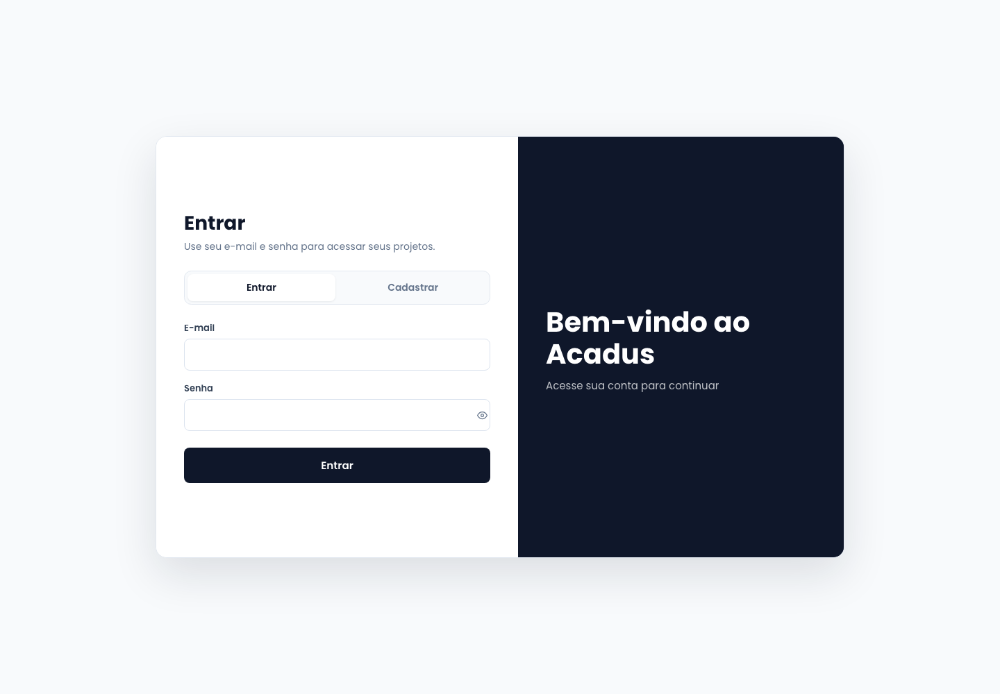
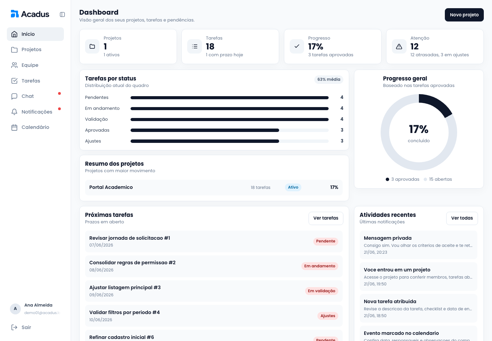
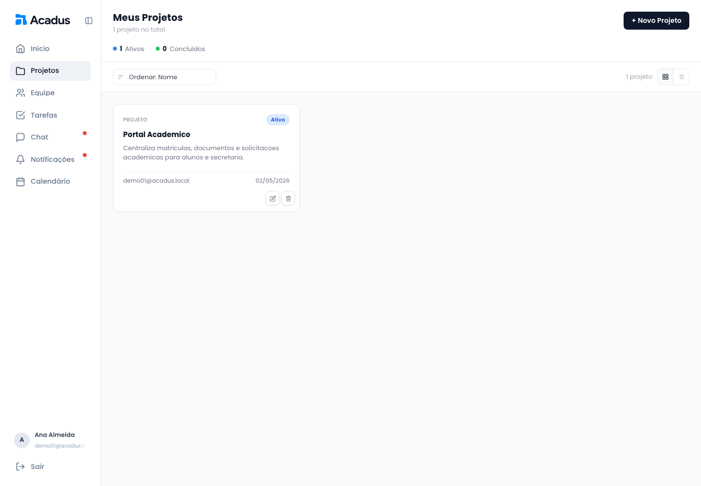
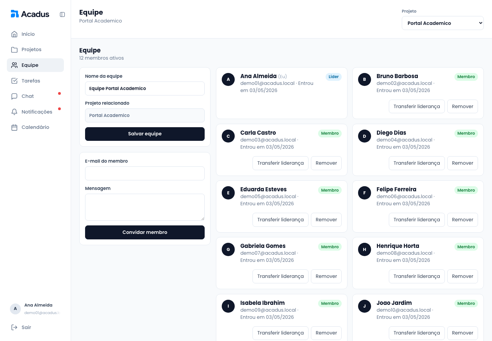
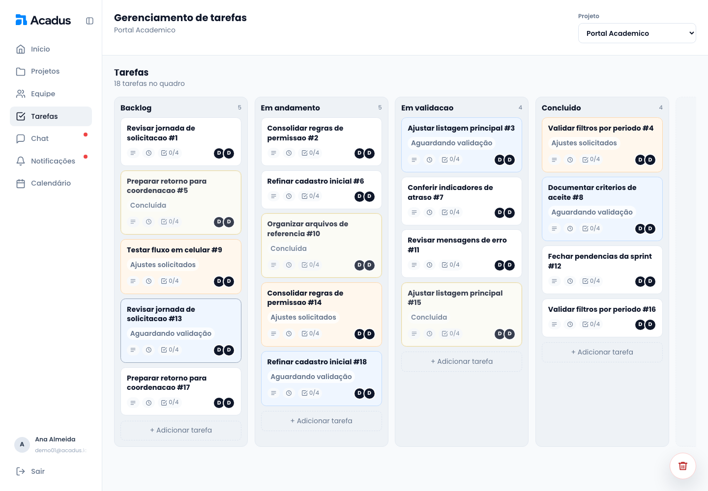
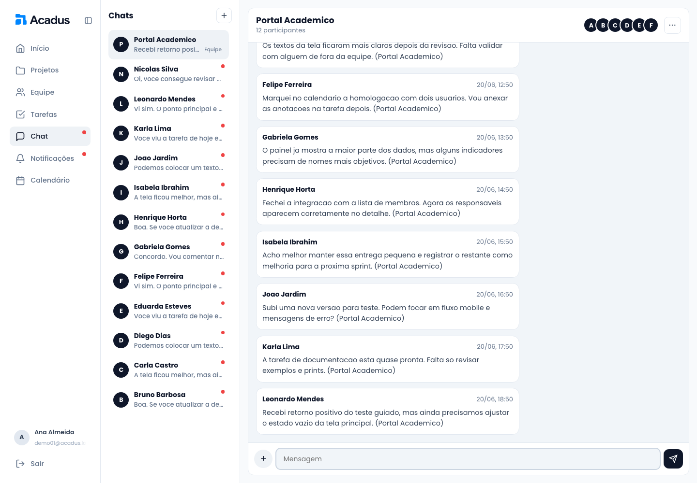
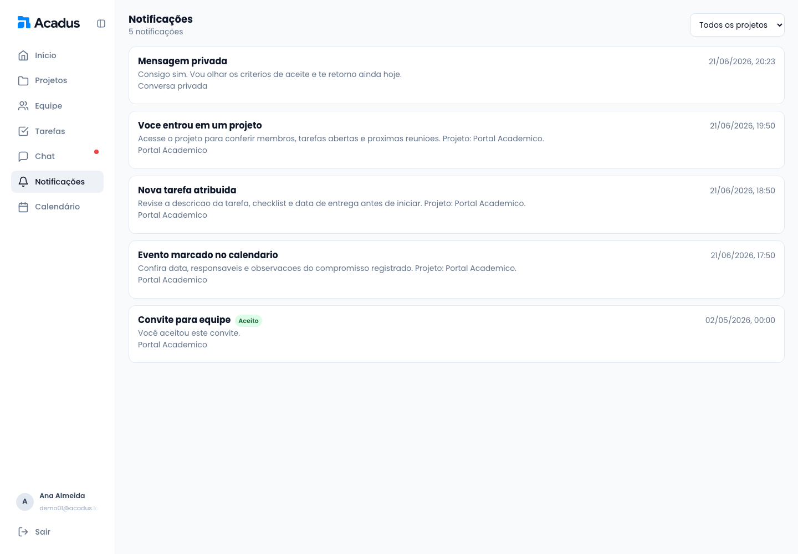
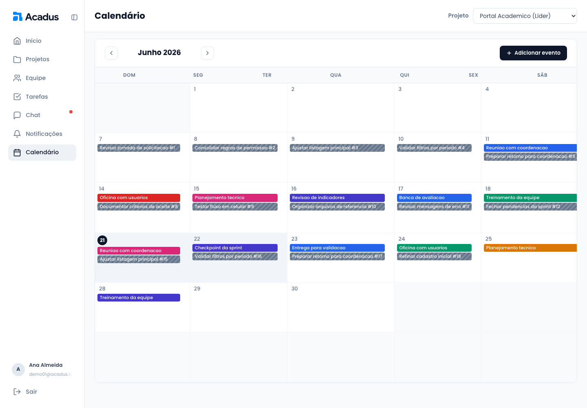
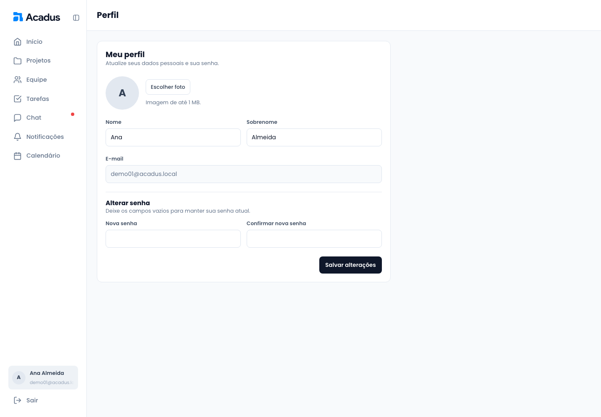

## 6. Interface do sistema

A interface do Acadus foi desenvolvida para concentrar as atividades de projetos acadêmicos em uma navegação única. As áreas autenticadas compartilham a barra lateral, a identificação do usuário e o mesmo padrão de cores, tipografia, espaçamento, botões, campos e mensagens de retorno.

Em telas menores, a navegação é adaptada para um menu móvel. Os formulários apresentam validação dos campos e as ações importantes utilizam modais de confirmação ou notificações visuais.

As capturas desta seção foram realizadas na versão final do sistema, executada com dados demonstrativos para tornar visíveis os principais componentes e estados da interface.

## 6.1. Tela principal e autenticação

Após o login, o usuário é direcionado ao dashboard. A tela reúne indicadores calculados a partir dos projetos aos quais o usuário pertence, incluindo quantidade de projetos, tarefas, progresso, pendências, distribuição por status, próximos prazos e notificações recentes.

O cadastro solicita nome, sobrenome, e-mail e senha. No login, o sistema valida as credenciais e mantém os dados básicos do usuário na sessão do navegador.

O dashboard apresenta os totais do usuário, a distribuição das tarefas por status, a taxa de conclusão, o resumo dos projetos, os próximos prazos e as atividades recentes. Os valores são consolidados a partir dos projetos em que o usuário possui vínculo ativo.

## 6.2. Gerenciamento de projetos

A tela de projetos mostra somente os projetos dos quais o usuário participa. Cada item apresenta nome, descrição, status e informações resumidas. O líder pode criar, editar ou excluir um projeto. Um membro pode acessar o projeto ou sair dele, preservando o histórico associado à sua participação.

O formulário de projeto permite informar nome, descrição e imagem de capa. Projetos novos são criados com status ativo, e o criador é registrado como líder. A listagem pode ser exibida em cartões ou tabela e apresenta ações conforme o papel do usuário.

## 6.3. Gerenciamento de equipe

A tela de equipe apresenta o líder, os membros ativos e o histórico de convites, recusas, cancelamentos, saídas e remoções. O líder pode convidar usuários pelo e-mail, reenviar convites, remover integrantes e solicitar a transferência da liderança.

O destinatário recebe o convite na área de notificações e pode aceitar ou recusar. Convites cancelados não podem ser aceitos. A interface diferencia líder, membro, usuário atual e participantes que já não fazem parte da equipe.

No desktop, os formulários de configuração e convite ficam à esquerda, enquanto os participantes são distribuídos em uma grade que aproveita o espaço horizontal.

## 6.4. Gerenciamento de tarefas

As tarefas são organizadas em um quadro Kanban pertencente ao projeto selecionado. As colunas e os cartões podem ser reordenados por arrastar e soltar, com persistência da posição. O líder cria colunas e tarefas, define responsáveis, prazos, descrição, anexos e checklist.

Membros podem movimentar cartões, marcar itens do checklist, adicionar comentários e enviar tarefas para validação. O líder pode solicitar ajustes ou aprovar a entrega. Os estados de validação, ajustes e aprovação possuem identificação visual própria.

Os cartões exibem indicadores resumidos de descrição, prazo, checklist, anexos e responsáveis. A lixeira permite recuperar ou excluir definitivamente colunas e tarefas removidas.

## 6.5. Comunicação e notificações

A área de chat reúne conversas de equipe e conversas privadas. A lista lateral é ordenada pela atividade mais recente e identifica mensagens ainda não visualizadas. O histórico possui rolagem própria, permitindo que o cabeçalho e o campo de envio permaneçam acessíveis mesmo em conversas longas.

Mensagens podem incluir anexos. O autor pode editar ou excluir sua mensagem, mantendo a indicação de edição e o histórico necessário. Usuários que saíram de um projeto preservam acesso somente de leitura ao período permitido do chat da equipe.

A área de notificações reúne convites, transferências de liderança, atribuições e alterações de tarefas, remoções de equipe e novas conversas privadas. Cada item apresenta seu estado e permite consultar os detalhes.

## 6.6. Cronograma e calendário

O calendário apresenta eventos e prazos de tarefas dos projetos do usuário. É possível navegar entre os meses, criar eventos, consultar detalhes, editar informações e excluir eventos mediante confirmação.

Os formulários de evento permitem definir título, descrição, data, horário, projeto e participantes. As tarefas com prazo são incluídas automaticamente na visualização do calendário.

## 6.7. Perfil do usuário

Na página de perfil, o usuário pode alterar nome, sobrenome, senha e foto. O e-mail é utilizado como identificação da conta e não pode ser modificado. A foto cadastrada é reutilizada nos avatares da equipe, das tarefas, do chat e da barra lateral.

