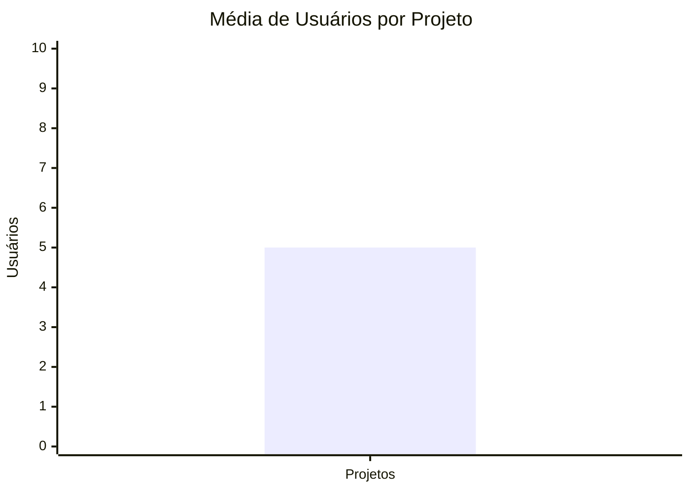
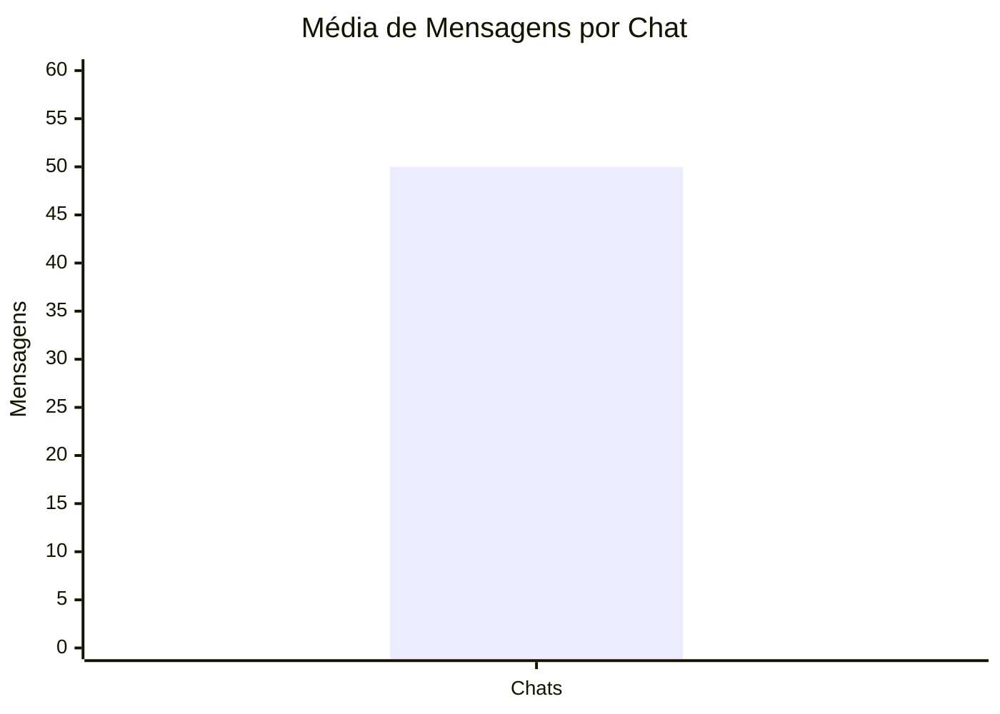
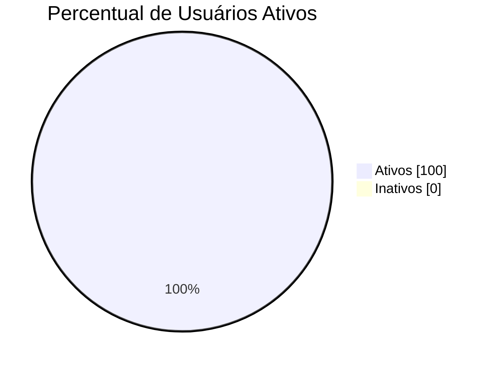
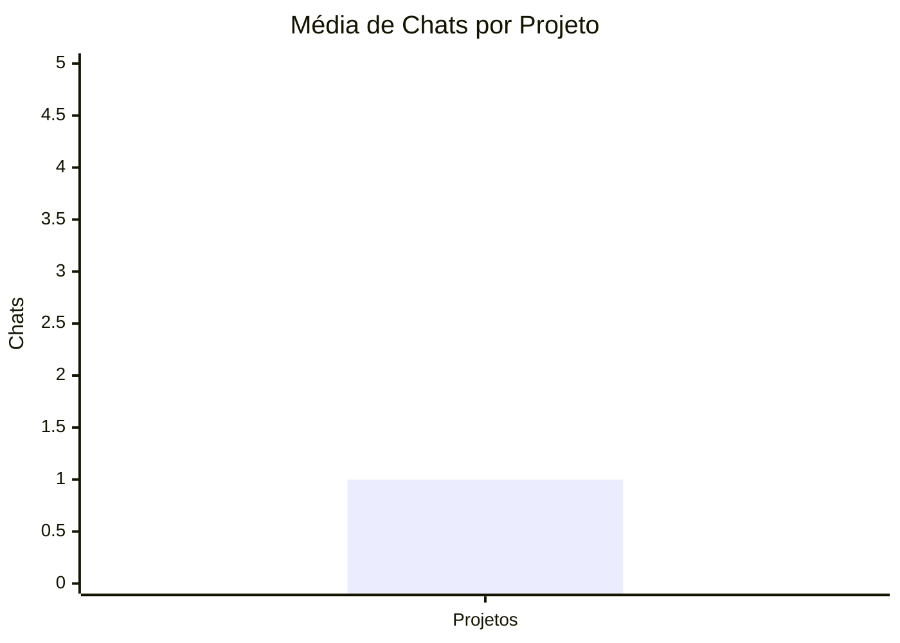

## 5. Indicadores de desempenho

| **Indicador**                 | **Objetivos**                                                    | **Descrição**                                                                                              | **Fonte de dados**                | **Fórmula de cálculo**                                           |
| ----------------------------- | ---------------------------------------------------------------- | ---------------------------------------------------------------------------------------------------------- | --------------------------------- | ---------------------------------------------------------------- |
| Média de usuários por projeto | Avaliar o nível de colaboração nos projetos                      | Mede a quantidade média de usuários vinculados aos projetos cadastrados                                    | Tabelas UsuárioProjeto e Projeto  | número total de participantes / número total de projetos         |
| Média de mensagens por chat   | Avaliar o nível de comunicação entre os membros das equipes      | Mede a quantidade média de mensagens enviadas em cada chat                                                 | Tabelas Mensagem e Chat           | número total de mensagens / número total de chats                |
| Percentual de usuários ativos | Monitorar o engajamento dos usuários na plataforma               | Mede a porcentagem de usuários que acessaram ou realizaram alguma ação no período analisado                | Tabela Usuário                    | (número de usuários ativos / número total de usuários) × 100     |
| Média de chats por projeto    | Avaliar o uso dos canais de comunicação dos projetos             | Mede a quantidade média de chats criados por projeto                                                       | Tabelas Chat e Projeto            | número total de chats / número total de projetos                 |
| Taxa de participação em chats | Verificar o envolvimento dos membros nas discussões dos projetos | Mede o percentual de usuários que enviaram ao menos uma mensagem em relação aos participantes dos projetos | Tabelas Mensagem e UsuárioProjeto | (usuários que enviaram mensagens / usuários participantes) × 100 |

## 1. Média de Usuários por Projeto

### Gráfico



### Consulta SQL

```sql
SELECT
    ROUND(
        COUNT(*) /
        (SELECT COUNT(*) FROM projeto),
        2
    ) AS media_usuarios_por_projeto
FROM usuario_projeto;
```

---

## 2. Média de Mensagens por Chat

### Gráfico



### Consulta SQL

```sql
SELECT
    ROUND(
        COUNT(*) /
        COUNT(DISTINCT tipo_chat),
        2
    ) AS media_mensagens_por_chat
FROM chat_mensagem;
```

---

## 3. Percentual de Usuários Ativos

### Gráfico



### Consulta SQL

```sql
SELECT
    ROUND(
        (
            COUNT(DISTINCT autor_email) * 100.0
        ) /
        (
            SELECT COUNT(*)
            FROM usuario
        ),
        2
    ) AS percentual_usuarios_ativos
FROM chat_mensagem;
```

---

## 4. Média de Chats por Projeto

### Gráfico



### Consulta SQL

```sql
SELECT
    ROUND(
        COUNT(DISTINCT tipo_chat) /
        (
            SELECT COUNT(*)
            FROM projeto
        ),
        2
    ) AS media_chats_por_projeto
FROM chat_mensagem;
```

---

## 5. Taxa de Participação em Chats

### Gráfico


### Consulta SQL

```sql
SELECT
    ROUND(
        (
            COUNT(DISTINCT autor_email) * 100.0
        ) /
        (
            SELECT COUNT(DISTINCT id_usuario)
            FROM usuario_projeto
        ),
        2
    ) AS taxa_participacao_chats
FROM chat_mensagem;
```

---
