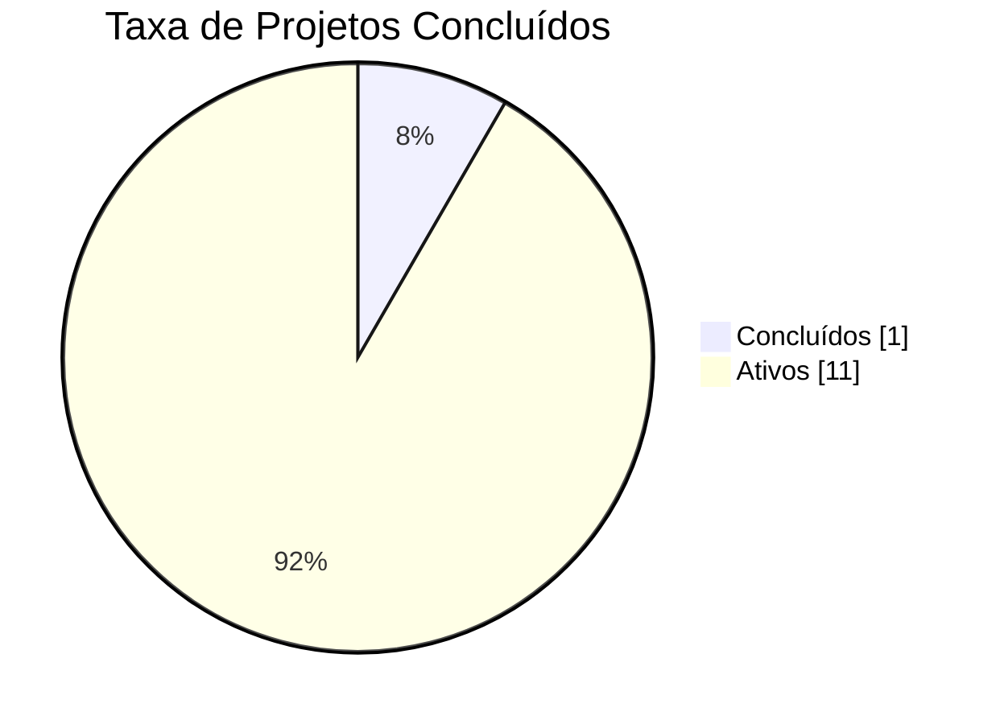
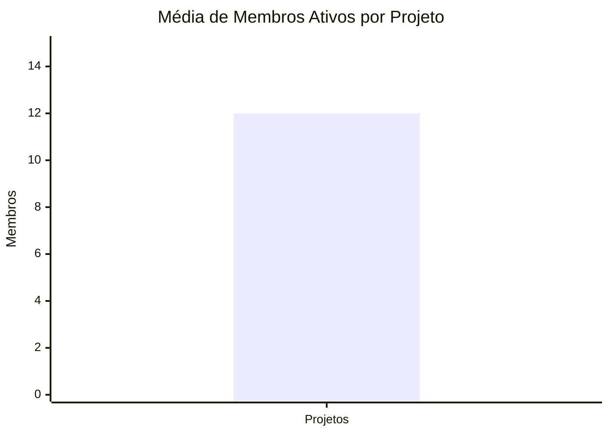
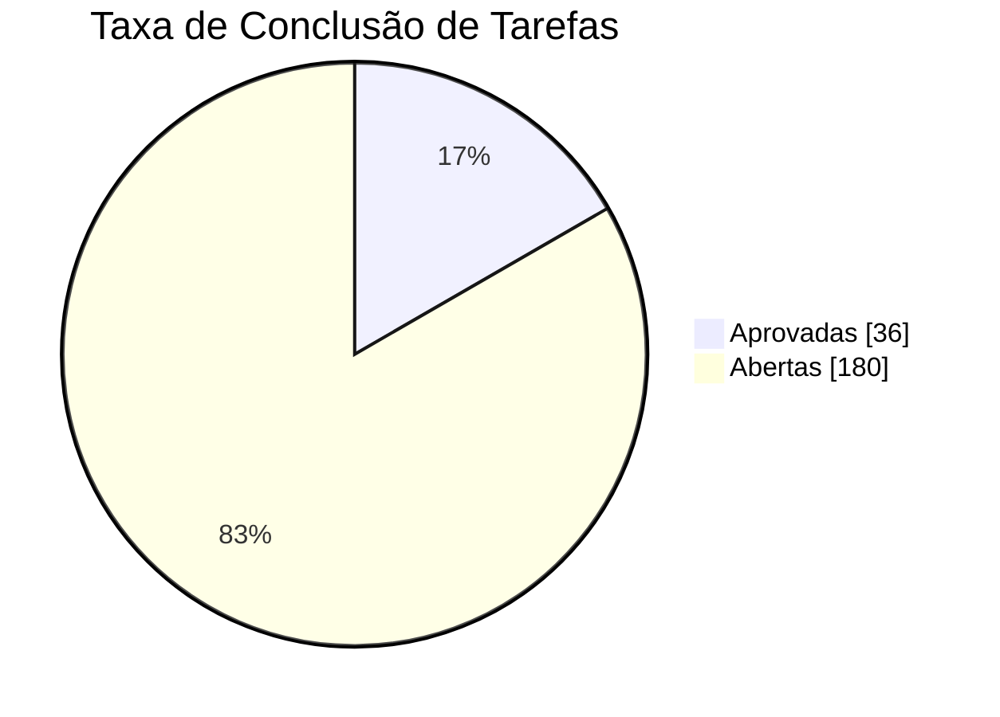
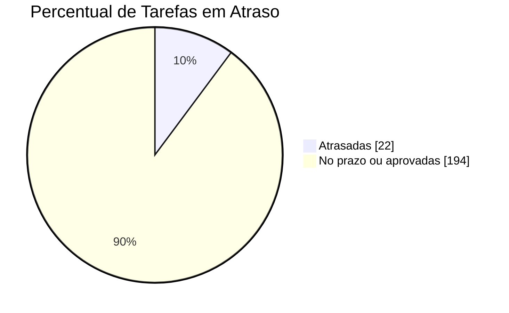
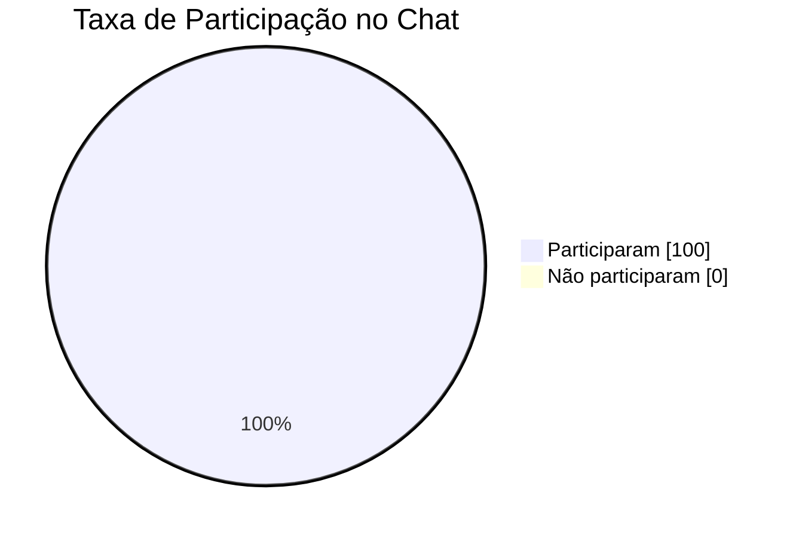
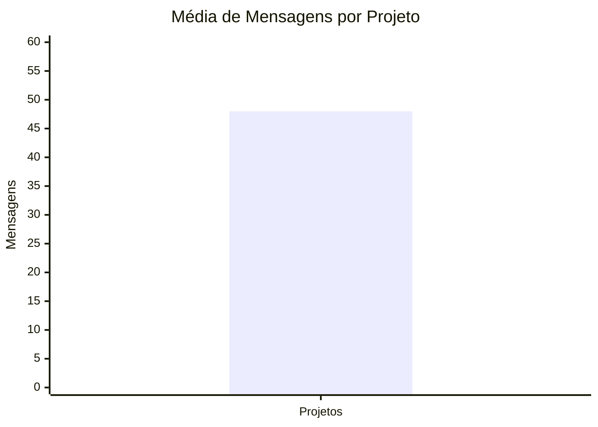

## 5. Indicadores de desempenho

| **Indicador**                         | **Objetivos**                                                   | **Descrição**                                                                                  | **Fonte de dados**                   | **Fórmula de cálculo**                                                    |
| ------------------------------------- | --------------------------------------------------------------- | ---------------------------------------------------------------------------------------------- | ------------------------------------ | ------------------------------------------------------------------------- |
| Taxa de projetos concluídos           | Acompanhar o andamento geral dos projetos                       | Mede o percentual de projetos que já foram finalizados em relação ao total de projetos          | Tabela projeto                       | (número de projetos concluídos / número total de projetos) × 100          |
| Média de membros ativos por projeto   | Avaliar o tamanho médio das equipes cadastradas                 | Mede a quantidade média de membros ativos vinculados aos projetos                               | Tabelas membro_equipe e projeto      | número de membros ativos / número total de projetos                       |
| Taxa de conclusão de tarefas          | Verificar o avanço das entregas dos projetos                    | Mede o percentual de tarefas aprovadas em relação ao total de tarefas não excluídas             | Tabela tarefa                        | (número de tarefas aprovadas / número total de tarefas não excluídas) × 100 |
| Percentual de tarefas em atraso       | Identificar pendências que podem afetar o cronograma            | Mede o percentual de tarefas com prazo vencido e que ainda não foram aprovadas                  | Tabela tarefa                        | (número de tarefas atrasadas / número total de tarefas com prazo) × 100    |
| Taxa de participação no chat          | Verificar o envolvimento dos membros nas conversas dos projetos | Mede o percentual de membros ativos que enviaram ao menos uma mensagem no chat da equipe        | Tabelas chat_mensagem e membro_equipe | (membros que enviaram mensagens / membros ativos) × 100                   |
| Média de mensagens por projeto        | Avaliar o uso da comunicação dentro dos projetos                | Mede a quantidade média de mensagens de equipe registradas por projeto                          | Tabelas chat_mensagem e projeto      | número total de mensagens de equipe / número total de projetos            |

## 1. Taxa de Projetos Concluídos

### Gráfico



### Consulta SQL

```sql
SELECT
    ROUND(
        SUM(CASE WHEN status = 'CONCLUIDO' THEN 1 ELSE 0 END) * 100.0 /
        NULLIF(COUNT(*), 0),
        2
    ) AS taxa_projetos_concluidos
FROM projeto;
```

---

## 2. Média de Membros Ativos por Projeto

### Gráfico



### Consulta SQL

```sql
SELECT
    ROUND(
        COUNT(*) /
        NULLIF((SELECT COUNT(*) FROM projeto), 0),
        2
    ) AS media_membros_ativos_por_projeto
FROM membro_equipe
WHERE status = 'ACEITO'
  AND data_saida IS NULL;
```

---

## 3. Taxa de Conclusão de Tarefas

### Gráfico



### Consulta SQL

```sql
SELECT
    ROUND(
        SUM(CASE WHEN status = 'APROVADA' THEN 1 ELSE 0 END) * 100.0 /
        NULLIF(COUNT(*), 0),
        2
    ) AS taxa_conclusao_tarefas
FROM tarefa
WHERE COALESCE(excluida, 0) = 0;
```

---

## 4. Percentual de Tarefas em Atraso

### Gráfico



### Consulta SQL

```sql
SELECT
    ROUND(
        SUM(CASE
            WHEN prazo < CURRENT_DATE
             AND status <> 'APROVADA'
            THEN 1 ELSE 0
        END) * 100.0 /
        NULLIF(COUNT(*), 0),
        2
    ) AS percentual_tarefas_atrasadas
FROM tarefa
WHERE prazo IS NOT NULL
  AND COALESCE(excluida, 0) = 0;
```

---

## 5. Taxa de Participação no Chat

### Gráfico



### Consulta SQL

```sql
SELECT
    ROUND(
        COUNT(DISTINCT autor_email) * 100.0 /
        NULLIF((
            SELECT COUNT(DISTINCT email)
            FROM membro_equipe
            WHERE status = 'ACEITO'
              AND data_saida IS NULL
        ), 0),
        2
    ) AS taxa_participacao_chat
FROM chat_mensagem
WHERE tipo_chat = 'EQUIPE'
  AND COALESCE(excluida, 0) = 0;
```

---

## 6. Média de Mensagens por Projeto

### Gráfico



### Consulta SQL

```sql
SELECT
    ROUND(
        COUNT(*) /
        NULLIF((SELECT COUNT(*) FROM projeto), 0),
        2
    ) AS media_mensagens_por_projeto
FROM chat_mensagem
WHERE tipo_chat = 'EQUIPE'
  AND projeto_id IS NOT NULL
  AND COALESCE(excluida, 0) = 0;
```

---
