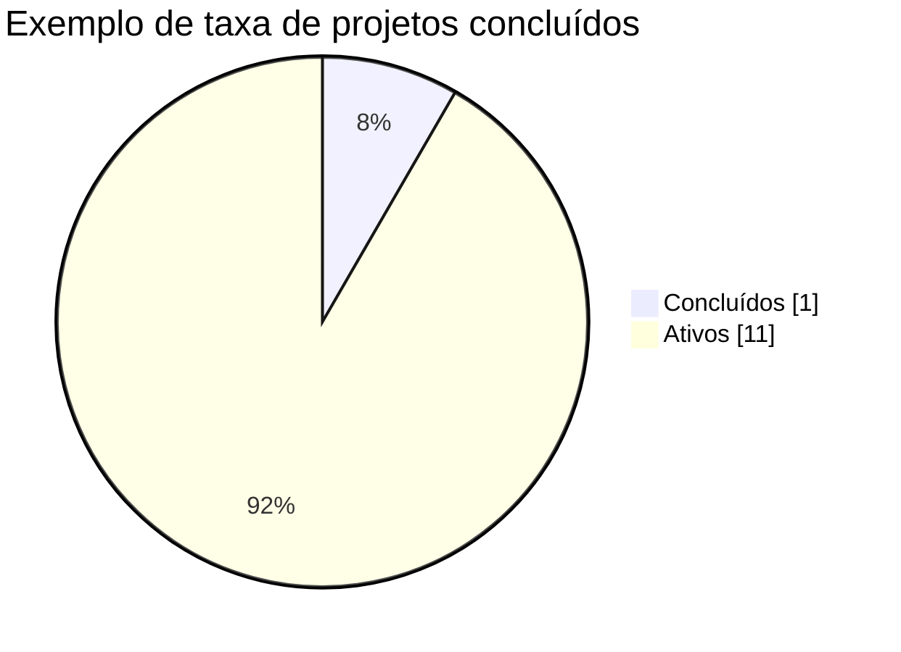
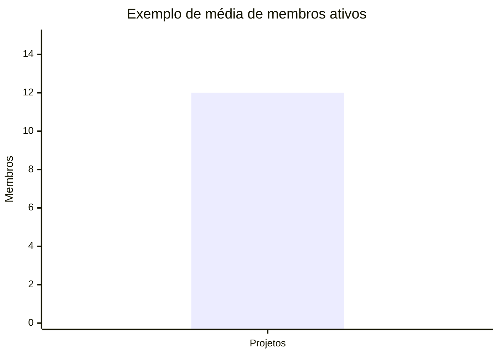
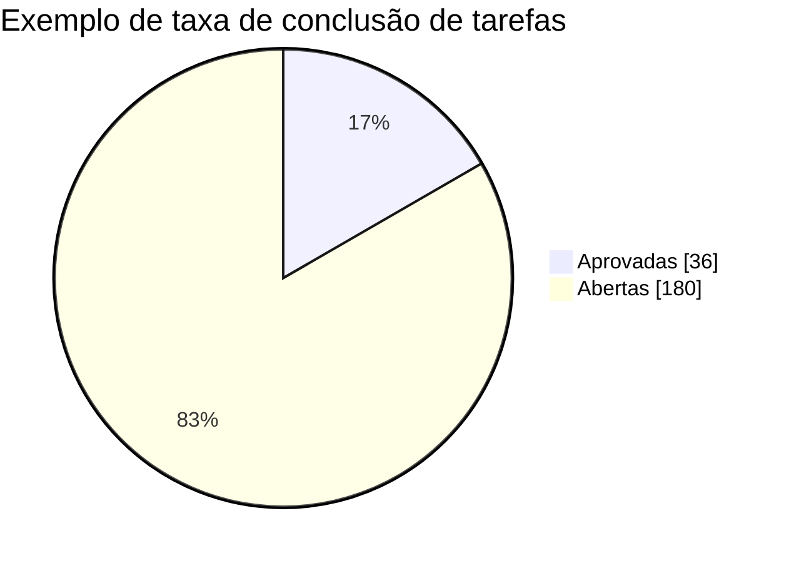
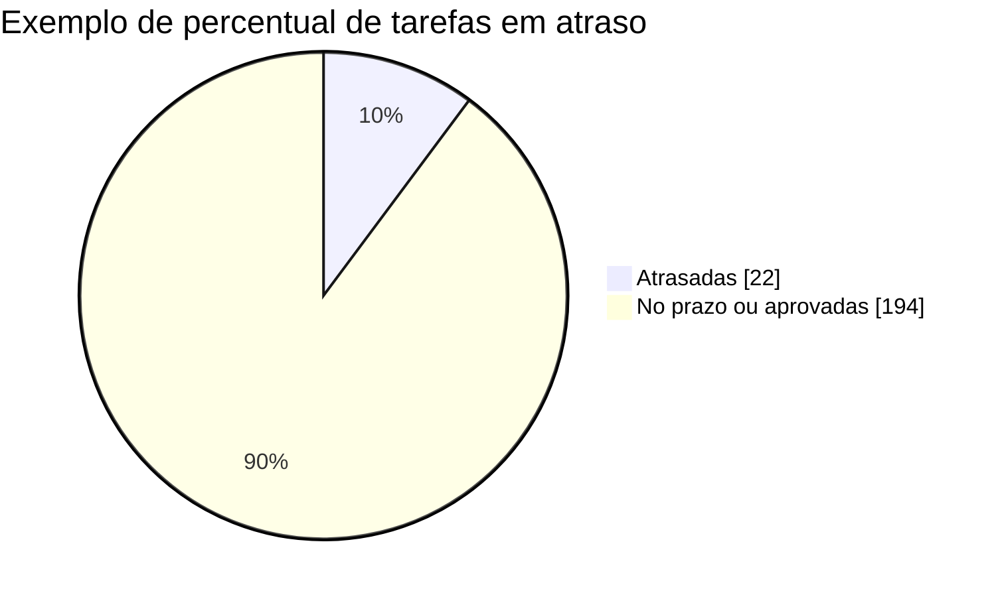
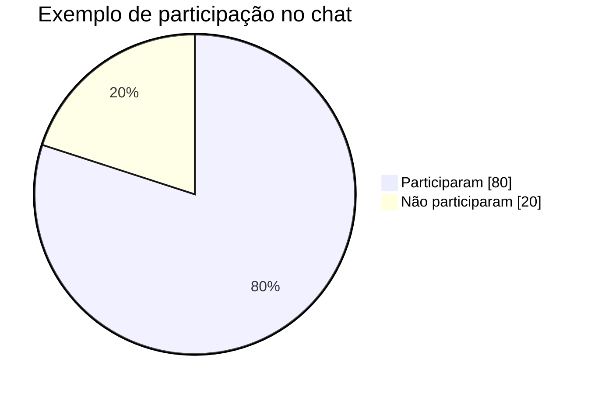
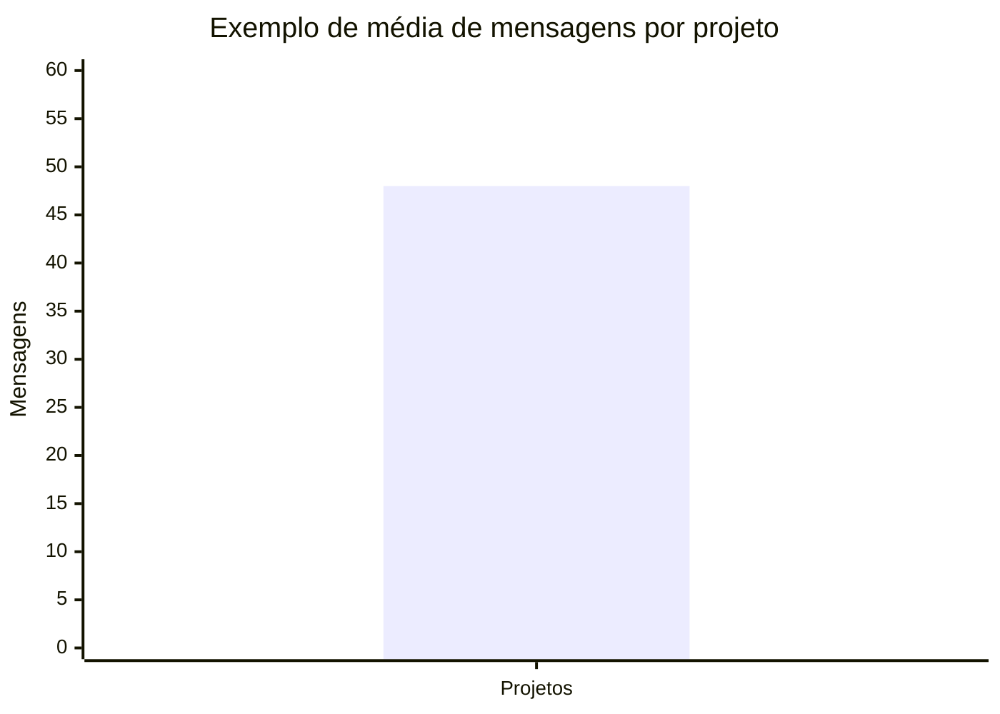

## 5. Indicadores de desempenho

Os indicadores são calculados diretamente a partir dos registros persistidos no MySQL. Os nomes abaixo correspondem às tabelas e colunas físicas do banco de dados, geradas a partir das entidades JPA do back-end.

As consultas desta seção medem a base inteira. No dashboard da aplicação, o cálculo é limitado aos projetos do usuário logado: `membro_equipe.email` deve ser igual ao e-mail da sessão, `membro_equipe.status = 'ACEITO'` e `membro_equipe.data_saida IS NULL`.

| **Indicador** | **Fonte exata no banco** | **Fórmula** |
| --- | --- | --- |
| Taxa de projetos concluídos | `projeto.id`, `projeto.status` | projetos com `status = 'CONCLUIDO'` / total de projetos × 100 |
| Média de membros ativos por projeto | `membro_equipe.id`, `membro_equipe.status`, `membro_equipe.data_saida`, `projeto.id` | membros aceitos sem data de saída / total de projetos |
| Taxa de conclusão de tarefas | `tarefa.id`, `tarefa.status`, `tarefa.excluida` | tarefas aprovadas / tarefas não excluídas × 100 |
| Percentual de tarefas em atraso | `tarefa.id`, `tarefa.prazo`, `tarefa.status`, `tarefa.excluida` | tarefas vencidas e não aprovadas / tarefas não excluídas com prazo × 100 |
| Taxa de participação no chat | `chat_mensagem.autor_email`, `chat_mensagem.tipo_chat`, `chat_mensagem.excluida`, `membro_equipe.email`, `membro_equipe.status`, `membro_equipe.data_saida` | membros ativos que enviaram mensagem / membros ativos × 100 |
| Média de mensagens por projeto | `chat_mensagem.id`, `chat_mensagem.tipo_chat`, `chat_mensagem.projeto_id`, `chat_mensagem.excluida`, `projeto.id` | mensagens de equipe não excluídas / total de projetos |

### 5.1. Taxa de projetos concluídos

**Objetivo:** acompanhar o andamento geral dos projetos cadastrados.

| **Tabela** | **Coluna** | **Uso no cálculo** |
| --- | --- | --- |
| `projeto` | `id` | identifica e conta cada projeto |
| `projeto` | `status` | separa `CONCLUIDO` de `ATIVO` |

**Cálculo:** quantidade de linhas em `projeto` com `status = 'CONCLUIDO'`, dividida pela quantidade total de linhas em `projeto`, multiplicada por 100.

```sql
SELECT
    ROUND(
        SUM(CASE WHEN status = 'CONCLUIDO' THEN 1 ELSE 0 END) * 100.0 /
        NULLIF(COUNT(id), 0),
        2
    ) AS taxa_projetos_concluidos
FROM projeto;
```



### 5.2. Média de membros ativos por projeto

**Objetivo:** avaliar o tamanho médio das equipes em atividade.

| **Tabela** | **Coluna** | **Uso no cálculo** |
| --- | --- | --- |
| `membro_equipe` | `id` | conta cada vínculo de membro |
| `membro_equipe` | `status` | considera apenas convites com valor `ACEITO` |
| `membro_equipe` | `data_saida` | exclui membros que já saíram ou foram removidos |
| `membro_equipe` | `projeto_id` | relaciona o membro ao projeto |
| `projeto` | `id` | fornece o total de projetos do denominador |

**Cálculo:** quantidade de vínculos com `status = 'ACEITO'` e `data_saida IS NULL`, dividida pela quantidade total de projetos.

```sql
SELECT
    ROUND(
        COUNT(me.id) /
        NULLIF((SELECT COUNT(p.id) FROM projeto p), 0),
        2
    ) AS media_membros_ativos_por_projeto
FROM membro_equipe me
WHERE me.status = 'ACEITO'
  AND me.data_saida IS NULL;
```



### 5.3. Taxa de conclusão de tarefas

**Objetivo:** medir o avanço das atividades registradas nos quadros Kanban.

| **Tabela** | **Coluna** | **Uso no cálculo** |
| --- | --- | --- |
| `tarefa` | `id` | identifica e conta cada tarefa |
| `tarefa` | `status` | considera concluída apenas a tarefa com valor `APROVADA` |
| `tarefa` | `excluida` | remove da base de cálculo as tarefas enviadas para a lixeira |
| `tarefa` | `projeto_id` | permite calcular o indicador por projeto |

**Cálculo:** tarefas não excluídas com `status = 'APROVADA'`, divididas pelo total de tarefas não excluídas, multiplicado por 100.

```sql
SELECT
    ROUND(
        SUM(CASE WHEN status = 'APROVADA' THEN 1 ELSE 0 END) * 100.0 /
        NULLIF(COUNT(id), 0),
        2
    ) AS taxa_conclusao_tarefas
FROM tarefa
WHERE COALESCE(excluida, 0) = 0;
```



### 5.4. Percentual de tarefas em atraso

**Objetivo:** identificar pendências que podem comprometer o cronograma.

| **Tabela** | **Coluna** | **Uso no cálculo** |
| --- | --- | --- |
| `tarefa` | `id` | identifica e conta cada tarefa |
| `tarefa` | `prazo` | compara a data prevista com `CURRENT_DATE` |
| `tarefa` | `status` | desconsidera tarefas com valor `APROVADA` |
| `tarefa` | `excluida` | desconsidera tarefas enviadas para a lixeira |
| `tarefa` | `projeto_id` | permite agrupar o atraso por projeto |

**Cálculo:** tarefas não excluídas cujo `prazo` é anterior à data atual e cujo `status` não é `APROVADA`, divididas pelo total de tarefas não excluídas que possuem prazo, multiplicado por 100.

```sql
SELECT
    ROUND(
        SUM(CASE
            WHEN prazo < CURRENT_DATE AND status <> 'APROVADA' THEN 1
            ELSE 0
        END) * 100.0 /
        NULLIF(COUNT(id), 0),
        2
    ) AS percentual_tarefas_atrasadas
FROM tarefa
WHERE prazo IS NOT NULL
  AND COALESCE(excluida, 0) = 0;
```



### 5.5. Taxa de participação no chat

**Objetivo:** verificar o envolvimento dos membros nas conversas de equipe.

| **Tabela** | **Coluna** | **Uso no cálculo** |
| --- | --- | --- |
| `chat_mensagem` | `autor_email` | identifica quais usuários enviaram mensagens |
| `chat_mensagem` | `tipo_chat` | restringe o cálculo às mensagens com valor `EQUIPE` |
| `chat_mensagem` | `excluida` | desconsidera mensagens excluídas logicamente |
| `chat_mensagem` | `projeto_id` | identifica o projeto da conversa |
| `membro_equipe` | `email` | identifica os membros da equipe |
| `membro_equipe` | `status` | considera apenas membros com valor `ACEITO` |
| `membro_equipe` | `data_saida` | considera apenas membros que ainda permanecem na equipe |

**Cálculo:** número de e-mails distintos de membros ativos que publicaram ao menos uma mensagem de equipe não excluída, dividido pelo número de e-mails distintos de membros ativos, multiplicado por 100.

```sql
SELECT
    ROUND(
        COUNT(DISTINCT me.email) * 100.0 /
        NULLIF((
            SELECT COUNT(DISTINCT ativos.email)
            FROM membro_equipe ativos
            WHERE ativos.status = 'ACEITO'
              AND ativos.data_saida IS NULL
        ), 0),
        2
    ) AS taxa_participacao_chat
FROM membro_equipe me
INNER JOIN chat_mensagem cm
        ON cm.projeto_id = me.projeto_id
       AND LOWER(cm.autor_email) = LOWER(me.email)
WHERE cm.tipo_chat = 'EQUIPE'
  AND COALESCE(cm.excluida, 0) = 0
  AND me.status = 'ACEITO'
  AND me.data_saida IS NULL;
```



### 5.6. Média de mensagens por projeto

**Objetivo:** avaliar o uso do canal de comunicação das equipes.

| **Tabela** | **Coluna** | **Uso no cálculo** |
| --- | --- | --- |
| `chat_mensagem` | `id` | conta cada mensagem registrada |
| `chat_mensagem` | `tipo_chat` | considera apenas mensagens com valor `EQUIPE` |
| `chat_mensagem` | `projeto_id` | garante que a mensagem pertence a um projeto |
| `chat_mensagem` | `excluida` | desconsidera mensagens excluídas logicamente |
| `projeto` | `id` | fornece o total de projetos do denominador |

**Cálculo:** quantidade de mensagens de equipe não excluídas e vinculadas a um projeto, dividida pela quantidade total de projetos.

```sql
SELECT
    ROUND(
        COUNT(cm.id) /
        NULLIF((SELECT COUNT(p.id) FROM projeto p), 0),
        2
    ) AS media_mensagens_por_projeto
FROM chat_mensagem cm
WHERE cm.tipo_chat = 'EQUIPE'
  AND cm.projeto_id IS NOT NULL
  AND COALESCE(cm.excluida, 0) = 0;
```



### 5.7. Dados exibidos no dashboard

O dashboard não consulta todos os projetos da base. Primeiro, o back-end seleciona os projetos vinculados ao usuário pela tabela `membro_equipe`, usando `email`, `status = 'ACEITO'` e `data_saida IS NULL`. Em seguida, o front-end busca as tarefas não excluídas de cada projeto selecionado.

| **Elemento do dashboard** | **Dados usados** | **Cálculo aplicado** |
| --- | --- | --- |
| Projetos | `membro_equipe.email`, `membro_equipe.status`, `membro_equipe.data_saida`, `projeto.id`, `projeto.status` | conta os projetos acessíveis e separa os que possuem `projeto.status = 'ATIVO'` |
| Tarefas | `tarefa.id`, `tarefa.projeto_id`, `tarefa.excluida`, `tarefa.prazo` | conta tarefas não excluídas dos projetos acessíveis e identifica prazo igual à data atual |
| Progresso geral | `tarefa.id`, `tarefa.status`, `tarefa.excluida` | tarefas com `status = 'APROVADA'` / total de tarefas não excluídas × 100 |
| Atenção | `tarefa.prazo`, `tarefa.status`, `tarefa.excluida` | conta tarefas não excluídas que estão vencidas ou possuem `status = 'AJUSTES'` |
| Média de checklist | `tarefa.progresso` | soma de `progresso` / quantidade de tarefas |
| Tarefas por status | `tarefa.status` | contagem para cada valor de status |
| Atividades recentes | `notificacao.destinatario_email`, `notificacao.data_hora` | seleciona as notificações do usuário e exibe as mais recentes |

Os valores apresentados nos gráficos Mermaid desta documentação são exemplos visuais. Os valores reais são calculados com os registros existentes no banco no momento da consulta.
