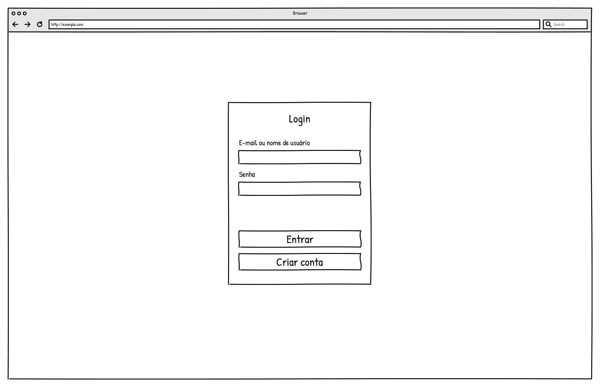
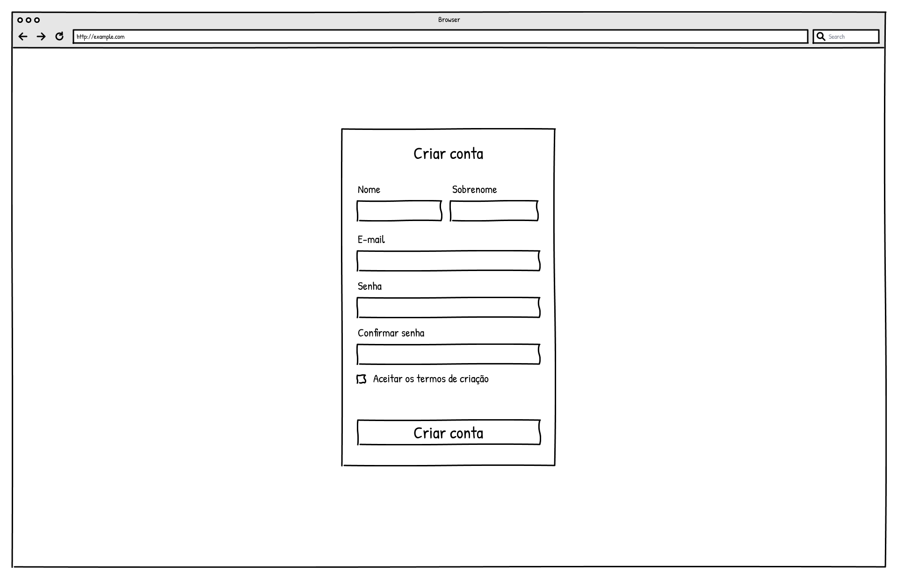
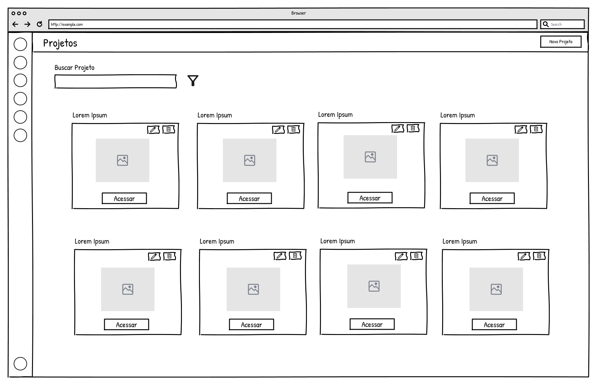
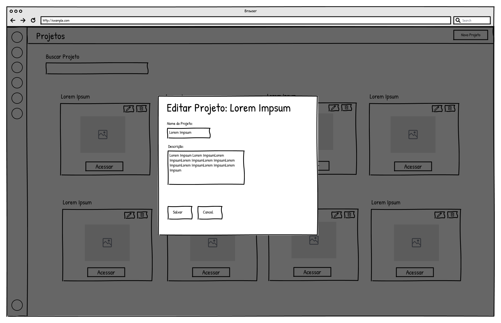
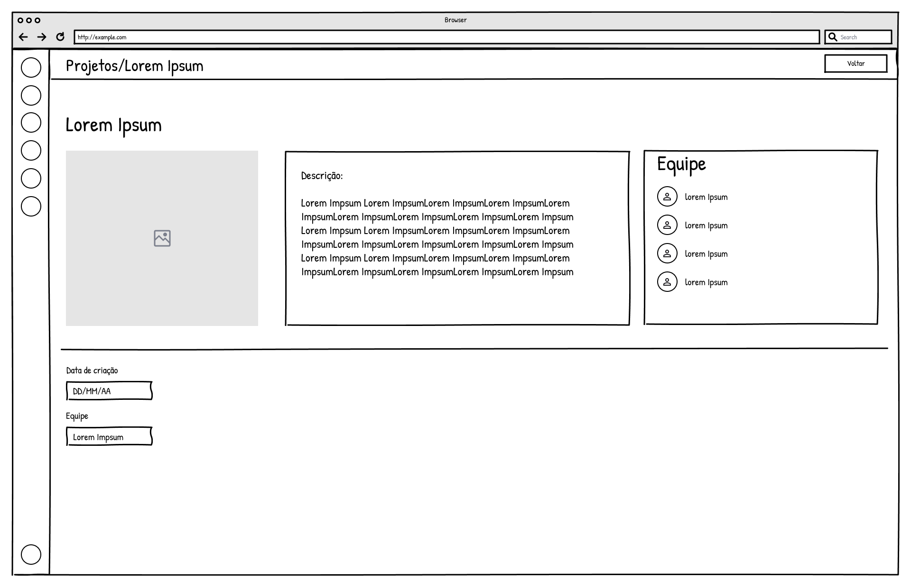

### 3.3.1 Processo 1 – Gerenciamento de Projetos

O processo de Gerenciamento de Projetos tem como objetivo permitir a criação, visualização, edição, exclusão, acesso e saída dos projetos acadêmicos pelos usuários do sistema, de acordo com seus respectivos papéis (líder ou membro).

Esse fluxo tem início com o acesso do usuário ao sistema, sendo necessário realizar o login ou, caso ainda não possua cadastro, efetuar o cadastro informando os dados solicitados. Após a autenticação, o usuário é direcionado para a tela de visualização de projetos, na qual são exibidos todos os projetos aos quais está vinculado.

Nessa tela, o usuário pode ordenar os projetos e escolher o modo de visualização. A partir dessa tela, diferentes ações podem ser realizadas. Qualquer usuário autenticado pode criar um novo projeto e passa a ser seu líder. Após a criação, o projeto integra a lista de projetos disponíveis.

Além disso, o líder pode editar projetos existentes, atualizando suas informações, ou excluí-los, mediante confirmação da ação. Os membros podem visualizar, acessar ou sair dos projetos dos quais participam.

Por fim, ao selecionar um projeto, o usuário acessa seus detalhes, permitindo o acesso a outros processos do sistema, como o gerenciamento de equipe, de tarefas e da comunicação.

Como oportunidade de melhoria em relação ao cenário atual, destaca-se a centralização das informações em um único ambiente, possibilitando melhor organização dos projetos e evitando a dispersão de dados em diferentes ferramentas. Além disso, o processo permite maior controle das ações realizadas pelos usuários, mantendo as operações administrativas sob responsabilidade do líder e preservando o histórico quando um membro sai de um projeto.

#### Modelo BPMN

#### Detalhamento das atividades

Os nomes das tabelas e colunas foram mantidos como aparecem no banco de dados para facilitar a conferência em um visualizador como o Beekeeper Studio.

**01. Acessar sistema - tabela usuario**

| **Campo no banco** | **Tipo** | **Restrições** | **Valor default** |
|--------------------|----------|----------------|-------------------|
| email            | Texto    | obrigatório; usuário deve estar cadastrado | |
| senha            | Texto    | obrigatório; deve corresponder ao usuário | |

| **Comandos** | **Destino** | **Tipo** |
|--------------|-------------|----------|
| Entrar       | Visualizar projetos | default |
| Criar conta  | Cadastro | default |

**02. Cadastro - tabela usuario**

| **Campo no banco** | **Tipo** | **Restrições** | **Valor default** |
|--------------------|----------|----------------|-------------------|
| id               | Número   | gerado automaticamente | |
| nome             | Texto    | obrigatório; até 100 caracteres | |
| sobrenome        | Texto    | obrigatório; até 100 caracteres | |
| email            | Texto    | obrigatório; formato válido; único; até 150 caracteres | |
| senha            | Texto    | obrigatório; 6 a 255 caracteres | |

| **Comandos** | **Destino** | **Tipo** |
|--------------|-------------|----------|
| Criar conta  | Visualizar projetos | default |
| Cancelar     | Acessar sistema | cancel |

**03. Visualizar projetos - tabelas projeto e membro_equipe**

| **Campo no banco** | **Tipo** | **Restrições** | **Valor default** |
|--------------------|----------|----------------|-------------------|
| membro_equipe.email | Texto | corresponde ao usuário autenticado | |
| membro_equipe.status | Texto | somente vínculos com valor ACEITO | |
| membro_equipe.data_saida | Data e hora | deve estar vazio para projetos ativos do usuário | |
| projeto.nome_projeto | Texto | nome exibido na listagem | |
| projeto.status | Texto | valores ATIVO ou CONCLUIDO | |

| **Comandos** | **Destino** | **Tipo** |
|--------------|-------------|----------|
| Criar projeto | Criar projeto | default |
| Editar projeto | Editar projeto | default |
| Excluir projeto | Excluir projeto | default |
| Acessar projeto | Detalhes do projeto | default |
| Sair do projeto | Confirmar saída | default |

**04. Criar projeto - tabelas projeto e membro_equipe**

| **Campo no banco** | **Tipo** | **Restrições** | **Valor default** |
|--------------------|----------|----------------|-------------------|
| projeto.nome_projeto | Texto | obrigatório; 3 a 100 caracteres | |
| projeto.descricao | Texto | opcional; até 500 caracteres | |
| projeto.capa_url | Texto | opcional; imagem de capa | |
| projeto.data_criacao | Data | gerada automaticamente | data atual |
| projeto.nome_equipe | Texto | gerado automaticamente a partir do nome do projeto | Equipe + nome do projeto |
| projeto.lider_email | Texto | e-mail do usuário que criou o projeto | |
| projeto.status | Texto | valores ATIVO ou CONCLUIDO | ATIVO |
| membro_equipe.projeto_id | Número | relaciona o líder ao projeto criado | projeto atual |
| membro_equipe.email | Texto | e-mail do líder | |
| membro_equipe.papel | Texto | papel inicial do criador | LIDER |
| membro_equipe.status | Texto | vínculo inicial do criador | ACEITO |
| membro_equipe.data_convite | Data | gerada automaticamente | data atual |
| membro_equipe.data_entrada | Data e hora | gerada automaticamente | data e hora atuais |
| membro_equipe.transferencia_pendente | Booleano | gerado automaticamente | false |
| membro_equipe.bloqueado | Booleano | gerado automaticamente | false |

| **Comandos** | **Destino** | **Tipo** |
|--------------|-------------|----------|
| Salvar projeto | Visualizar projetos | default |
| Cancelar | Visualizar projetos | cancel |

**05. Editar projeto - tabela projeto**

| **Campo no banco** | **Tipo** | **Restrições** | **Valor default** |
|--------------------|----------|----------------|-------------------|
| nome_projeto     | Texto    | obrigatório; 3 a 100 caracteres | valor atual |
| descricao        | Texto    | opcional; até 500 caracteres | valor atual |
| capa_url         | Texto    | opcional; imagem de capa | valor atual |
| status           | Texto    | valores ATIVO ou CONCLUIDO | valor atual |

| **Comandos** | **Destino** | **Tipo** |
|--------------|-------------|----------|
| Salvar alterações | Visualizar projetos | default |
| Cancelar | Visualizar projetos | cancel |

**06. Excluir projeto - tabelas projeto, tarefa, quadro_coluna, chat_mensagem e membro_equipe**

A exclusão remove o registro da tabela projeto e os registros relacionados nas tabelas tarefa, quadro_coluna, chat_mensagem e membro_equipe.

| **Comandos** | **Destino** | **Tipo** |
|--------------|-------------|----------|
| Confirmar exclusão | Visualizar projetos | default |
| Cancelar | Visualizar projetos | cancel |

**07. Acessar projeto - tabelas projeto e membro_equipe**

| **Campo no banco** | **Tipo** | **Restrições** | **Valor default** |
|--------------------|----------|----------------|-------------------|
| projeto.id       | Número   | projeto selecionado deve existir | |
| membro_equipe.status | Texto | vínculo do usuário deve estar como ACEITO | |
| membro_equipe.data_saida | Data e hora | deve estar vazio | |

| **Comandos** | **Destino** | **Tipo** |
|--------------|-------------|----------|
| Abrir projeto | Detalhes do projeto | default |

**08. Sair do projeto - tabelas membro_equipe e notificacao**

| **Campo no banco** | **Tipo** | **Restrições** | **Valor default** |
|--------------------|----------|----------------|-------------------|
| membro_equipe.data_saida | Data e hora | preenchida automaticamente; o líder deve transferir a liderança antes de sair | data e hora atuais |
| membro_equipe.transferencia_pendente | Booleano | volta para false | false |
| notificacao.tipo | Texto | identifica o aviso enviado ao líder | SAIDA_EQUIPE |
| notificacao.destinatario_email | Texto | e-mail do líder atual | |
| notificacao.projeto_id | Número | identifica o projeto deixado pelo membro | projeto atual |
| notificacao.data_hora | Data e hora | gerada automaticamente | data e hora atuais |

| **Comandos** | **Destino** | **Tipo** |
|--------------|-------------|----------|
| Confirmar | Visualizar projetos | default |
| Cancelar | Visualizar projetos | cancel |
