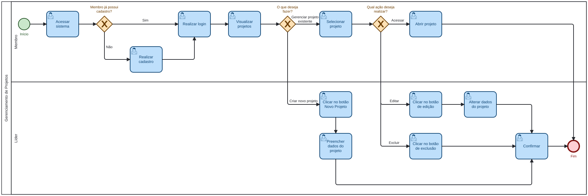
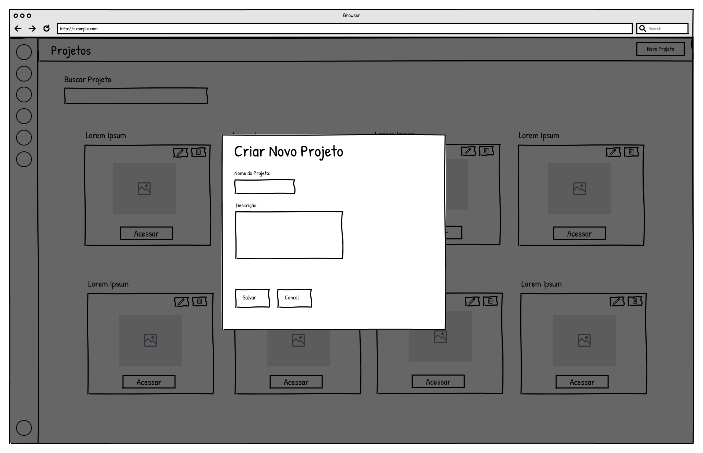
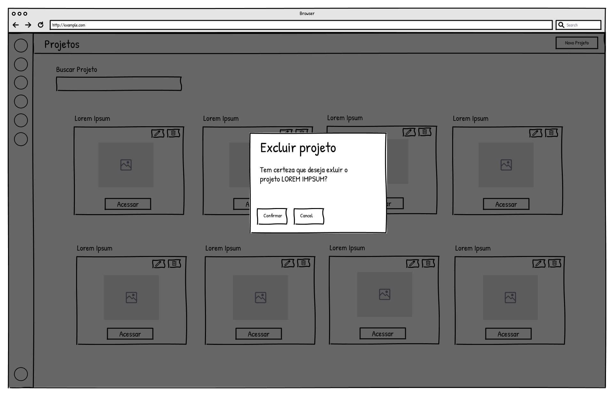

### 3.3.1 Processo 1 – Gerenciamento de Projetos

O gerenciamento de projetos tem como objetivo permitir a criação, edição, exclusão e acesso aos projetos acadêmicos pelos usuários do sistema, de acordo com seus respectivos papéis (líder ou membro).

Esse fluxo tem início com o acesso do usuário ao sistema, sendo necessário realizar o login ou, caso ainda não possua cadastro, efetuar o cadastro informando os dados solicitados. Após a autenticação, o usuário é direcionado para a tela de visualização de projetos, na qual são exibidos todos os projetos aos quais está vinculado.

Nessa tela, o usuário pode utilizar funcionalidades de busca e filtragem para localizar projetos específicos. A partir dessa tela, diferentes ações podem ser realizadas. Caso possua perfil de líder, o usuário poderá criar um novo projeto, informando os dados necessários para seu cadastro. Após a criação, o projeto passa a integrar a lista de projetos disponíveis.

Além disso, o líder pode editar projetos existentes, atualizando suas informações, ou excluí-los, mediante confirmação da ação. Já os membros possuem acesso restrito à visualização e ao acesso aos projetos.

Por fim, ao selecionar um projeto, o usuário acessa seus detalhes, permitindo o acesso a outros processos do sistema, como o gerenciamento de equipe e de tarefas.

Como oportunidade de melhoria em relação ao cenário atual, destaca-se a centralização das informações em um único ambiente, possibilitando melhor organização dos projetos e evitando a dispersão de dados em diferentes ferramentas. Além disso, o processo permite maior controle das ações realizadas pelos usuários, garantindo que apenas o líder tenha permissões de gerenciamento, enquanto os membros podem apenas visualizar e acessar os projetos.

#### Modelo BPMN

#### Detalhamento das atividades

**01. Visualizar projetos**

| **Campo** | **Tipo** | **Restrições** | **Valor default** |
| --- | --- | --- | --- |
| Projetos | Tabela | Exibir apenas projetos vinculados ao usuário logado |  |
| Buscar projeto | Caixa de texto | Opcional, até 100 caracteres |  |
| Filtro de status | Seleção múltipla | Valores: Ativo e/ou Concluído |  |

| **Comandos** | **Destino** | **Tipo** |
| --- | --- | --- |
| criarProjeto | Criar projeto | default |
| editarProjeto | Editar projeto | default |
| excluirProjeto | Excluir projeto | default |
| acessarProjeto | Acessar projeto | default |
| aplicarFiltro | Visualizar projetos | default |
| limparFiltro | Visualizar projetos | cancel |

**01.1 Wireframe**

**02. Criar projeto**

| **Campo** | **Tipo** | **Restrições** | **Valor default** |
| --- | --- | --- | --- |
| Nome do projeto | Caixa de texto | Obrigatório, 3 a 100 caracteres |  |
| Descrição | Área de texto | Opcional, até 500 caracteres |  |
| Data de criação | Data | Gerado automaticamente pelo sistema, formato dd-mm-aaaa |  |

| **Comandos** | **Destino** | **Tipo** |
| --- | --- | --- |
| salvarProjeto | Visualizar projetos | default |
| cancelarOperacao | Visualizar projetos | cancel |

**02.1 Wireframe**

**03. Editar projeto**

| **Campo** | **Tipo** | **Restrições** | **Valor default** |
| --- | --- | --- | --- |
| Nome do projeto | Caixa de texto | Obrigatório, 3 a 100 caracteres | Valor atual |
| Descrição | Área de texto | Opcional, até 500 caracteres | Valor atual |

| **Comandos** | **Destino** | **Tipo** |
| --- | --- | --- |
| salvarAlteracoes | Visualizar projetos | default |
| cancelarOperacao | Visualizar projetos | cancel |

**03.1 Wireframe**

**04. Excluir projeto**

| **Campo** | **Tipo** | **Restrições** | **Valor default** |
| --- | --- | --- | --- |
| Confirmação de exclusão | Seleção única | Valores: Sim ou Não |  |

| **Comandos** | **Destino** | **Tipo** |
| --- | --- | --- |
| confirmarExclusao | Visualizar projetos | default |
| cancelarOperacao | Visualizar projetos | cancel |

**04.1 Wireframe**

**05. Acessar projeto**

| **Campo** | **Tipo** | **Restrições** | **Valor default** |
| --- | --- | --- | --- |
| Projeto selecionado | Seleção única | O projeto deve existir na lista |  |

| **Comandos** | **Destino** | **Tipo** |
| --- | --- | --- |
| abrirProjeto | Detalhes do projeto | default |
