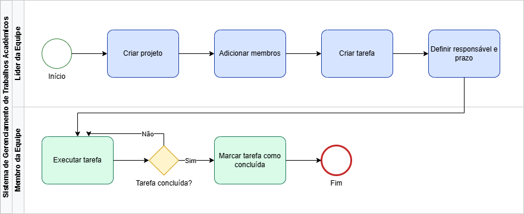
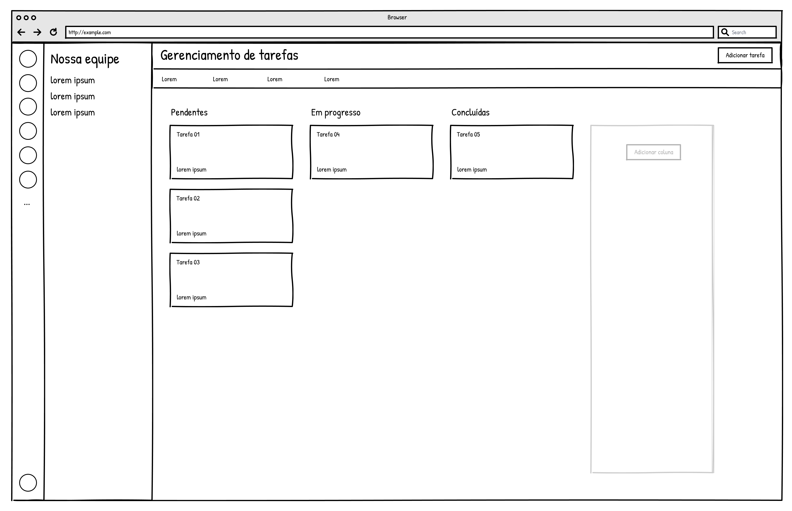
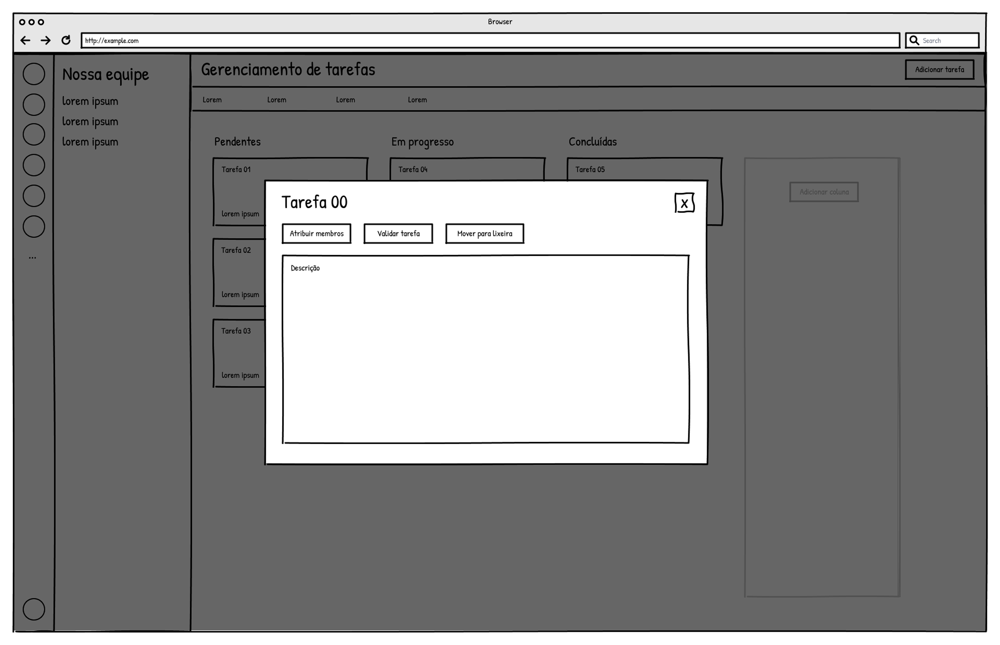

### 3.3.1 Processo 1 – Gerenciamento de Tarefas

O processo de gerenciamento de tarefas em projetos acadêmicos tem como objetivo organizar e acompanhar as atividades desenvolvidas pelas equipes, desde a criação do projeto até a conclusão das tarefas.

Como oportunidade de melhoria em relação ao cenário atual, destaca-se a centralização das informações em um único sistema, reduzindo a dispersão de dados entre diferentes ferramentas. Além disso, o processo proposto permite maior controle sobre prazos, responsabilidades e andamento das atividades, contribuindo para maior eficiência e produtividade das equipes.

#### Modelo BPMN

#### Detalhamento das atividades

### 3.3.1 Processo 1 – Gerenciamento de Tarefas

#### Detalhamento das atividades

**01. Criar tarefa**

| **Campo**        | **Tipo**         | **Restrições**                                   | **Valor default** |
|------------------|------------------|--------------------------------------------------|-------------------|
| Nome da tarefa   | Caixa de texto   | 3 a 100 caracteres                               |                   |
| Descrição        | Área de texto    | até 500 caracteres                               |                   |
| Responsável      | Seleção única    | deve selecionar usuário válido do grupo          |                   |
| Prazo            | Data             | formato dd-mm-aaaa; data futura                  |                   |

| **Comandos** | **Destino**          | **Tipo** |
|--------------|---------------------|----------|
| Salvar       | Visualizar tarefas  | default  |
| Cancelar     | Visualizar tarefas  | cancel   |

**02. Visualizar tarefas**

| **Campo**        | **Tipo**       | **Restrições**                         | **Valor default** |
|------------------|---------------|----------------------------------------|-------------------|
| Lista de tarefas | Tabela        | exibe tarefas do projeto do usuário    |                   |
| Status           | Seleção única | pendente / em progresso / concluída    | pendente          |

| **Comandos**       | **Destino**         | **Tipo** |
|--------------------|--------------------|----------|
| Abrir tarefa       | Visualizar tarefa  | default  |
| Adicionar tarefa   | Criar tarefa       | default  |

**03. Visualizar tarefa**

| **Campo**        | **Tipo**         | **Restrições**                        | **Valor default** |
|------------------|------------------|---------------------------------------|-------------------|
| Nome da tarefa   | Caixa de texto   | somente leitura                      |                   |
| Descrição        | Área de texto    | até 500 caracteres                   |                   |
| Responsável      | Seleção única    | deve existir no grupo                |                   |
| Status           | Seleção única    | pendente / em progresso / concluída  |                   |

| **Comandos**          | **Destino**              | **Tipo** |
|-----------------------|--------------------------|----------|
| Executar tarefa       | Executar tarefa          | default  |
| Validar tarefa        | Validar tarefas          | default  |
| Mover para lixeira    | Excluir tarefa           | default  |
| Fechar                | Visualizar tarefas       | cancel   |

**04. Executar tarefa**

| **Campo**        | **Tipo**         | **Restrições**                        | **Valor default** |
|------------------|------------------|---------------------------------------|-------------------|
| Progresso        | Número           | 0 a 100 (%)                          | 0                 |
| Comentário       | Área de texto    | até 300 caracteres                   |                   |
| Anexos           | Arquivo          | formatos: pdf, jpg, png; máx 5MB     |                   |

| **Comandos**             | **Destino**                 | **Tipo** |
|--------------------------|-----------------------------|----------|
| Atualizar progresso      | Atualizar progresso         | default  |
| Finalizar tarefa         | Enviar para validação       | default  |
| Cancelar                 | Visualizar tarefa           | cancel   |

**05. Atualizar progresso**

| **Campo**  | **Tipo** | **Restrições** | **Valor default** |
|------------|----------|----------------|-------------------|
| Progresso  | Número   | 0 a 100 (%)    |                   |

| **Comandos** | **Destino**        | **Tipo** |
|--------------|-------------------|----------|
| Salvar       | Executar tarefa   | default  |

**06. Enviar para validação**

| **Campo** | **Tipo** | **Restrições** | **Valor default** |
|-----------|----------|----------------|-------------------|
| -         | -        | -              | -                 |

| **Comandos** | **Destino**        | **Tipo** |
|--------------|-------------------|----------|
| Confirmar    | Validar tarefas   | default  |

**07. Validar tarefas**

| **Campo**  | **Tipo**         | **Restrições**         | **Valor default** |
|------------|------------------|------------------------|-------------------|
| Status     | Seleção única    | aprovado / reprovado   |                   |
| Comentário | Área de texto    | até 300 caracteres     |                   |

| **Comandos**       | **Destino**                     | **Tipo** |
|--------------------|--------------------------------|----------|
| Aprovar            | Fim (tarefa validada)          | default  |
| Solicitar ajustes  | Ajustar tarefa                 | default  |

**08. Excluir tarefa**

| **Campo**     | **Tipo** | **Restrições** | **Valor default** |
|---------------|----------|----------------|-------------------|
| Confirmação   | Booleano | true / false   | false             |

| **Comandos** | **Destino**              | **Tipo** |
|--------------|--------------------------|----------|
| Confirmar    | Fim (tarefa excluída)    | default  |
| Cancelar     | Visualizar tarefa        | cancel   | 

**Wireframe**

