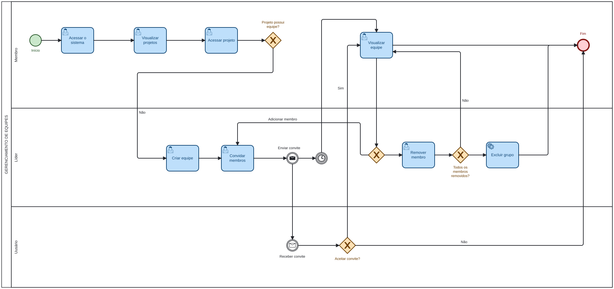
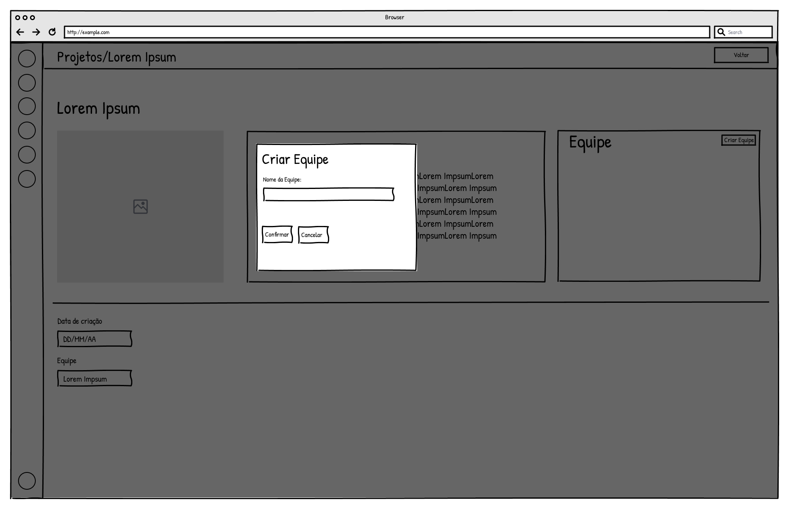
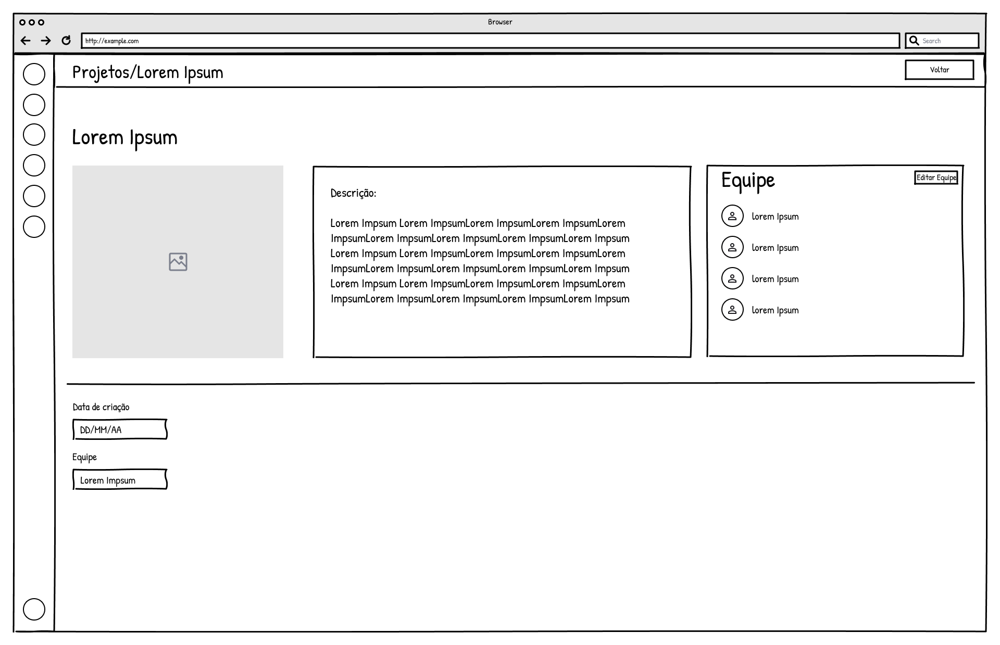
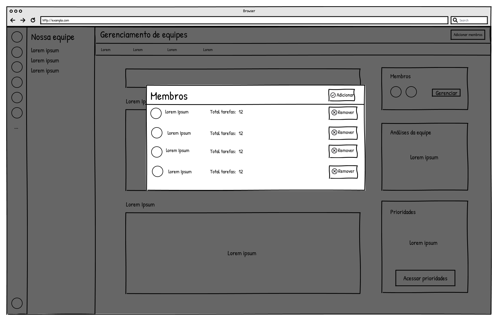
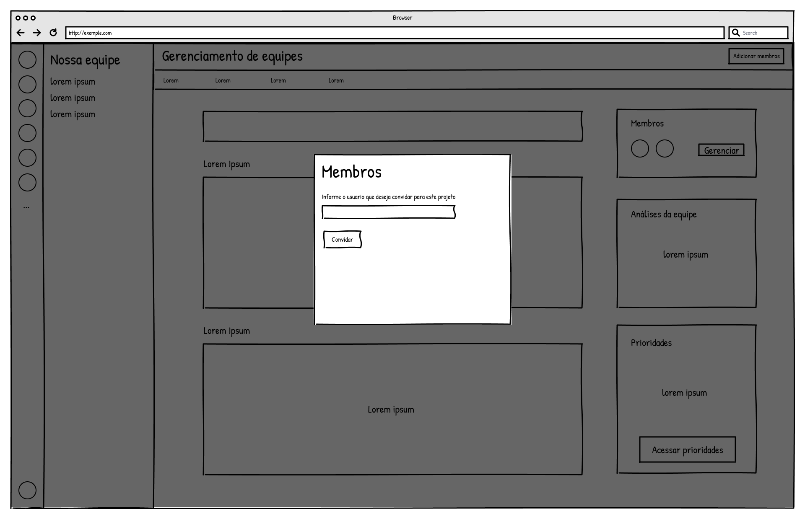
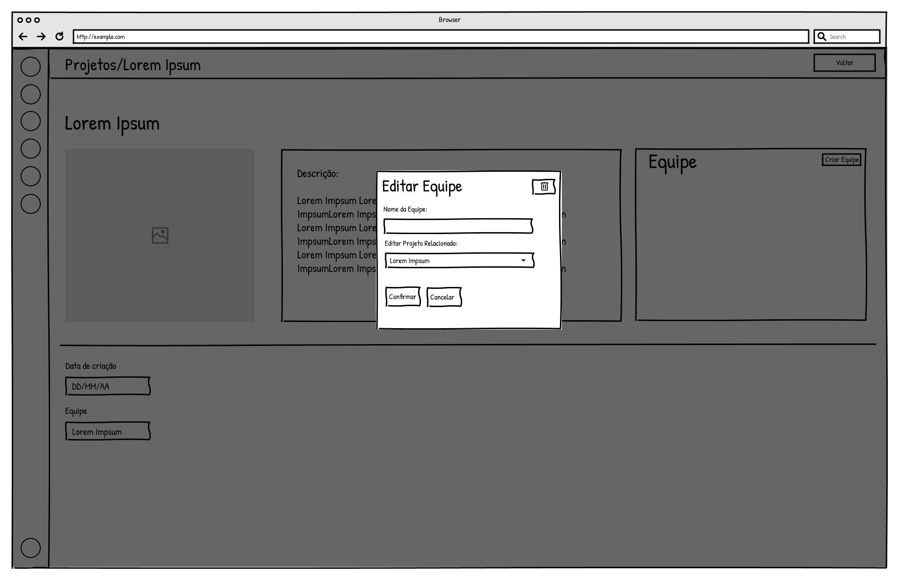
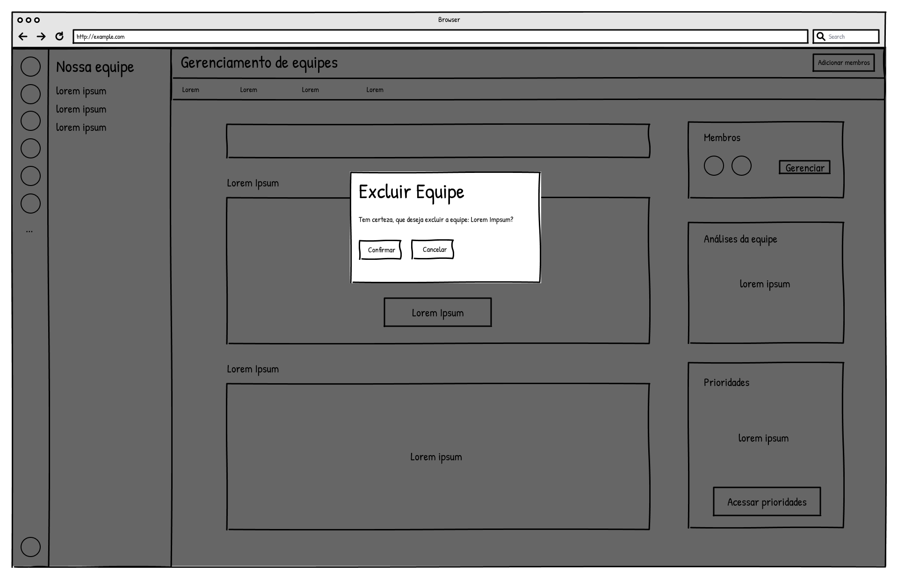

### 3.3.2 Processo 2 – Gerenciamento de Equipe

O processo de Gerenciamento de Equipe tem como objetivo organizar os participantes de cada projeto. O líder pode definir o nome da equipe, convidar membros, cancelar convites, remover participantes e transferir a liderança. O sistema também mantém o histórico de entradas e saídas, permitindo acompanhar a composição da equipe sem perder registros anteriores.

#### Modelo BPMN

#### Detalhamento das atividades

Os nomes das tabelas e colunas foram mantidos como aparecem no banco de dados para facilitar a conferência em um visualizador como o Beekeeper Studio. Não existe uma tabela separada para equipe: o nome da equipe fica armazenado no projeto.

**01. Criar equipe - tabela projeto**

| **Campo no banco** | **Tipo** | **Restrições** | **Valor default** |
|--------------------|----------|----------------|-------------------|
| nome_equipe      | Texto    | obrigatório; 3 a 100 caracteres | Equipe + nome do projeto |
| nome_projeto     | Texto    | somente leitura nesta atividade | valor atual |

| **Comandos** | **Destino** | **Tipo** |
|--------------|-------------|----------|
| Salvar equipe | Visualizar equipe | default |
| Cancelar | Fim do processo | cancel |

**02. Convidar membro - tabelas membro_equipe e notificacao**

| **Campo no banco** | **Tipo** | **Restrições** | **Valor default** |
|--------------------|----------|----------------|-------------------|
| projeto_id       | Número   | identifica o projeto da equipe | projeto atual |
| email            | Texto    | obrigatório; formato válido; até 150 caracteres | |
| mensagem         | Texto    | opcional; até 300 caracteres | |
| convidado_por    | Texto    | e-mail do líder que enviou o convite | |
| papel            | Texto    | novo convidado entra como membro | MEMBRO |
| status           | Texto    | situação inicial do convite | PENDENTE |
| data_convite     | Data     | gerada automaticamente | data atual |
| transferencia_pendente | Booleano | gerado automaticamente | false |
| bloqueado        | Booleano | gerado automaticamente | false |
| removido         | Booleano | gerado automaticamente | false |
| oculto_lista     | Booleano | gerado automaticamente | false |
| notificacao.tipo | Texto    | identifica a notificação recebida pelo convidado | CONVITE |
| notificacao.destinatario_email | Texto | e-mail do convidado | |
| notificacao.referencia_id | Número | identifica o vínculo criado em membro_equipe | |
| notificacao.status | Texto | acompanha a situação do convite | PENDENTE |

| **Comandos** | **Destino** | **Tipo** |
|--------------|-------------|----------|
| Enviar convite | Aceitar ou recusar convite | default |
| Voltar | Visualizar equipe | cancel |

**03. Aceitar ou recusar convite - tabelas membro_equipe e notificacao**

| **Campo no banco** | **Tipo** | **Restrições** | **Valor default** |
|--------------------|----------|----------------|-------------------|
| status           | Texto    | altera de PENDENTE para ACEITO ou RECUSADO | PENDENTE |
| data_entrada     | Data e hora | preenchida automaticamente quando o convite é aceito | |
| data_saida       | Data e hora | permanece vazia quando o convite é aceito | |
| notificacao.status | Texto | atualizado com a resposta do convidado | ACEITO ou RECUSADO |

Quando o convite é recusado, o líder também recebe uma nova linha em notificacao com tipo CONVITE_RECUSADO.

| **Comandos** | **Destino** | **Tipo** |
|--------------|-------------|----------|
| Aceitar | Visualizar equipe | default |
| Recusar | Fim do processo | cancel |

**04. Visualizar equipe - tabelas projeto e membro_equipe**

| **Campo no banco** | **Tipo** | **Restrições** | **Valor default** |
|--------------------|----------|----------------|-------------------|
| projeto.nome_equipe | Texto | nome apresentado para a equipe | |
| projeto.lider_email | Texto | e-mail do líder atual | |
| membro_equipe.email | Texto | identifica cada participante convidado | |
| membro_equipe.papel | Texto | valores LIDER ou MEMBRO | |
| membro_equipe.status | Texto | valores PENDENTE, ACEITO, RECUSADO ou CANCELADO | |
| membro_equipe.data_entrada | Data e hora | informa quando o convite foi aceito | |
| membro_equipe.data_saida | Data e hora | preenchida quando o membro sai da equipe | |
| membro_equipe.removido | Booleano | indica remoção de um membro que já havia entrado | false |
| membro_equipe.oculto_lista | Booleano | indica se um vínculo antigo foi ocultado da listagem | false |

| **Comandos** | **Destino** | **Tipo** |
|--------------|-------------|----------|
| Adicionar membro | Convidar membro | default |
| Remover membro | Remover membro | default |
| Transferir liderança | Solicitar transferência de liderança | default |
| Editar equipe | Editar equipe | default |
| Sair da equipe | Confirmar saída | default |

**05. Solicitar transferência de liderança - tabelas membro_equipe e notificacao**

| **Campo no banco** | **Tipo** | **Restrições** | **Valor default** |
|--------------------|----------|----------------|-------------------|
| transferencia_pendente | Booleano | somente para membro ativo com status = ACEITO | true após a solicitação |
| status_transferencia | Texto | registra a situação da solicitação | PENDENTE |
| notificacao.tipo | Texto | identifica o aviso enviado ao novo líder | LIDERANCA |
| notificacao.destinatario_email | Texto | e-mail do membro escolhido | |
| notificacao.status | Texto | acompanha a situação da solicitação | PENDENTE |

| **Comandos** | **Destino** | **Tipo** |
|--------------|-------------|----------|
| Transferir liderança | Responder transferência de liderança | default |
| Cancelar | Visualizar equipe | cancel |

**06. Responder transferência de liderança - tabelas membro_equipe, projeto e notificacao**

| **Campo no banco** | **Tipo** | **Restrições** | **Valor default** |
|--------------------|----------|----------------|-------------------|
| membro_equipe.transferencia_pendente | Booleano | volta para false após a resposta | false |
| membro_equipe.status_transferencia | Texto | registra a resposta | ACEITO ou RECUSADO |
| membro_equipe.papel | Texto | ao aceitar, o novo líder recebe LIDER e o líder anterior recebe MEMBRO | |
| projeto.lider_email | Texto | atualizado com o e-mail do novo líder quando a transferência é aceita | |
| notificacao.status | Texto | atualizado com a resposta do membro | ACEITO ou RECUSADO |

| **Comandos** | **Destino** | **Tipo** |
|--------------|-------------|----------|
| Aceitar liderança | Visualizar equipe | default |
| Recusar | Visualizar equipe | cancel |

**07. Cancelar convite ou remover membro - tabelas membro_equipe e notificacao**

| **Campo no banco** | **Tipo** | **Restrições** | **Valor default** |
|--------------------|----------|----------------|-------------------|
| id               | Número   | identifica o vínculo removido | |
| status           | Texto    | muda para CANCELADO quando um convite pendente é cancelado | valor atual |
| mensagem         | Texto    | pode registrar a mensagem informada pelo líder | valor atual |
| data_saida       | Data e hora | preenchida ao remover membro que já aceitou o convite | data e hora atuais |
| transferencia_pendente | Booleano | volta para false ao remover membro ativo | false |
| removido         | Booleano | muda para true ao remover membro que já havia entrado | true |
| notificacao.tipo | Texto | mantém CONVITE no cancelamento ou recebe REMOCAO_EQUIPE na remoção de membro ativo | |
| notificacao.status | Texto | muda para CANCELADO quando um convite pendente é cancelado | |

Caso o convite ainda esteja com status = PENDENTE, o registro é mantido no banco com status = CANCELADO. Caso o membro já tenha aceitado, o registro é mantido como histórico com data_saida preenchida e removido = true.

| **Comandos** | **Destino** | **Tipo** |
|--------------|-------------|----------|
| Confirmar | Visualizar equipe com histórico atualizado | default |
| Cancelar | Visualizar equipe | cancel |

**08. Gerenciar histórico da equipe - tabelas membro_equipe e notificacao**

| **Campo no banco** | **Tipo** | **Restrições** | **Valor default** |
|--------------------|----------|----------------|-------------------|
| membro_equipe.oculto_lista | Booleano | pode mudar para true somente para vínculos que não estão ativos | false |
| membro_equipe.status | Texto | permite identificar convites recusados ou cancelados | |
| membro_equipe.data_saida | Data e hora | permite identificar participantes que já saíram | |

Ao convidar novamente uma pessoa, o sistema cria um novo registro em membro_equipe e uma nova notificação do tipo CONVITE. Assim, os registros anteriores continuam disponíveis para conferência.

| **Comandos** | **Destino** | **Tipo** |
|--------------|-------------|----------|
| Ocultar da lista | Visualizar equipe | default |
| Convidar novamente | Convidar membro | default |

**09. Editar equipe - tabela projeto**

| **Campo no banco** | **Tipo** | **Restrições** | **Valor default** |
|--------------------|----------|----------------|-------------------|
| nome_equipe      | Texto    | obrigatório; 3 a 100 caracteres | valor atual |
| nome_projeto     | Texto    | somente leitura nesta atividade | valor atual |

| **Comandos** | **Destino** | **Tipo** |
|--------------|-------------|----------|
| Salvar | Visualizar equipe | default |
| Cancelar | Visualizar equipe | cancel |

**10. Sair da equipe - tabelas membro_equipe e notificacao**

| **Campo no banco** | **Tipo** | **Restrições** | **Valor default** |
|--------------------|----------|----------------|-------------------|
| data_saida       | Data e hora | preenchida automaticamente; líder deve transferir a liderança antes de sair | data e hora atuais |
| transferencia_pendente | Booleano | volta para false | false |
| notificacao.tipo | Texto | identifica o aviso enviado ao líder | SAIDA_EQUIPE |
| notificacao.destinatario_email | Texto | e-mail do líder atual | |
| notificacao.projeto_id | Número | identifica o projeto da equipe | projeto atual |

| **Comandos** | **Destino** | **Tipo** |
|--------------|-------------|----------|
| Confirmar | Fim do processo e histórico mantido | default |
| Cancelar | Visualizar equipe | cancel |

