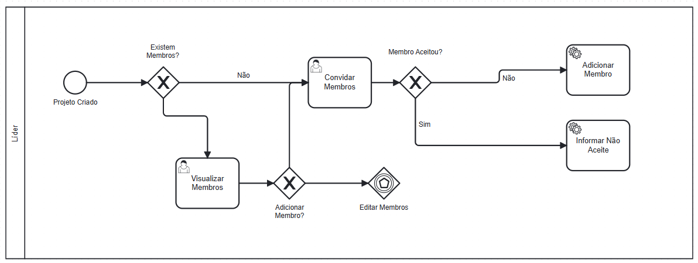
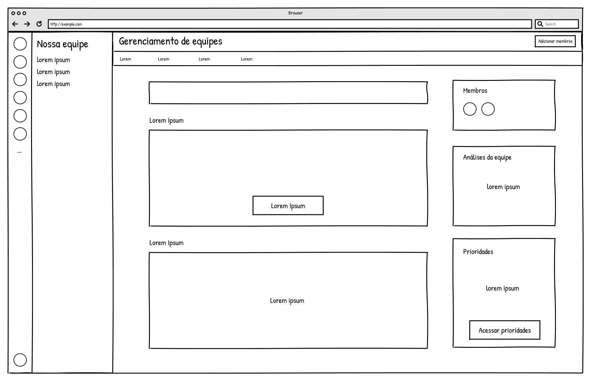

### 3.3.2 Processo 2 – Gestão de Grupos / Times

O processo de Gestão de Grupos / Times tem como objetivo facilitar a criação, organização e manutenção de grupos de trabalho, permitindo a definição de líderes, convite de membros, aprovação de entradas, remoção de membros e estruturação de subgrupos ou squads. Oportunidades de melhoria incluem reduzir o tempo de formação de times, aumentar a transparência na composição dos grupos e garantir a governança adequada sobre as equipes.

#### Modelo BPMN

#### Detalhamento das atividades

**01. Criar grupo**

| **Campo**        | **Tipo**         | **Restrições**                          | **Valor default** |
|------------------|------------------|-----------------------------------------|-------------------|
| Nome do Grupo    | Caixa de texto   | obrigatório; único                      |                   |
| Descrição        | Área de texto    | até 500 caracteres                      |                   |
| Tipo de Grupo    | Seleção única    | permanente / temporário / projeto       | permanente        |
| Data de Criação  | Data             | automática                              | data atual        |
| Visibilidade     | Seleção única    | público / privado                       | privado           |

| **Comandos** | **Destino**           | **Tipo** |
|--------------|----------------------|----------|
| Criar        | Convidar membros     | default  |
| Cancelar     | Fim do processo      | cancel   |

**02. Convidar membros**

| **Campo**            | **Tipo**         | **Restrições**                    | **Valor default** |
|----------------------|------------------|----------------------------------|-------------------|
| E-mail do Membro     | Caixa de texto   | formato válido de e-mail         |                   |
| Nome do Membro       | Caixa de texto   |                                  |                   |
| Papel Sugerido       | Seleção única    | membro / líder / observador      | membro            |
| Mensagem de Convite  | Área de texto    | até 300 caracteres               |                   |
| Data do Convite      | Data             | automática                       | data atual        |

| **Comandos**      | **Destino**                         | **Tipo** |
|-------------------|-------------------------------------|----------|
| Enviar convite    | Verificar aprovação necessária      | default  |
| Adicionar outro   | Convidar membros                   | default  |
| Pular             | Verificar aprovação necessária      | default  |
| Cancelar          | Fim do processo                     | cancel   |

**03. Verificar aprovação necessária**

| **Comandos** | **Destino**                  | **Tipo** |
|--------------|-----------------------------|----------|
| Sim          | Aprovar entrada de membro   | default  |
| Não          | Definir líder/coordenador   | default  |

**04. Aprovar entrada de membro**

| **Campo**        | **Tipo**         | **Restrições**            | **Valor default** |
|------------------|------------------|---------------------------|-------------------|
| Membro           | Caixa de texto   | obrigatório               |                   |
| Comentário       | Área de texto    | até 300 caracteres        |                   |

| **Comandos** | **Destino**                     | **Tipo** |
|--------------|--------------------------------|----------|
| Aprovar      | Definir líder/coordenador      | default  |
| Rejeitar     | Convidar membros               | default  |

**05. Definir líder/coordenador**

| **Campo**               | **Tipo**         | **Restrições**                             | **Valor default** |
|-------------------------|------------------|----------------------------------------------|-------------------|
| Líder Selecionado       | Seleção única    | deve ser membro do grupo                    |                   |
| Tipo de Liderança       | Seleção única    | única / compartilhada / rotativa            | única             |
| Data de Início          | Data             | automática                                  | data atual        |
| Data de Fim             | Data             | opcional                                    |                   |
| Permissões Especiais    | Múltipla escolha | aprovar membros, remover membros      |                   |

| **Comandos** | **Destino**                        | **Tipo** |
|--------------|-----------------------------------|----------|
| Confirmar    | Criar subgrupos/squads            | default  |
| Alterar      | Definir líder/coordenador         | default  |
| Cancelar     | Fim do processo                   | cancel   |

**06. Criar subgrupos/squads**

| **Campo**              | **Tipo**         | **Restrições**                  | **Valor default** |
|------------------------|------------------|---------------------------------|-------------------|
| Nome do Subgrupo       | Caixa de texto   | obrigatório                     |                   |
| Descrição              | Área de texto    | até 500 caracteres              |                   |
| Membros Designados     | Múltipla escolha | devem pertencer ao grupo        |                   |
| Líder do Subgrupo      | Seleção única    | deve pertencer ao grupo         |                   |
| Objetivo               | Área de texto    | até 300 caracteres              |                   |

| **Comandos**      | **Destino**         | **Tipo** |
|-------------------|--------------------|----------|
| Criar             | Grupo ativo        | default  |
| Adicionar outro   | Criar subgrupos/squads   | default  |
| Pular             | Grupo ativo        | default  |
| Cancelar          | Fim do processo    | cancel   |

**07. Grupo ativo**

| **Campo**        | **Tipo** | **Restrições** | **Valor default** |
|------------------|----------|----------------|-------------------|
| -                | -        | -              | -                 |

| **Comandos**           | **Destino**                    | **Tipo** |
|------------------------|-------------------------------|----------|
| Remover membro         | Remover membro                | default  |
| Alterar líder          | Alterar líder/coordenador     | default  |
| Encerrar grupo         | Fim (grupo encerrado)         | default  |

**08. Remover membro**

| **Campo**                    | **Tipo**         | **Restrições**                  | **Valor default** |
|------------------------------|------------------|---------------------------------|-------------------|
| Membro a Remover             | Seleção única    | obrigatório                     |                   |
| Motivo da Remoção            | Área de texto    | até 300 caracteres              |                   |
| Data da Remoção              | Data             | automática                      | data atual        |
| Notificar Membro             | Seleção única    | sim / não                       | sim               |
| Transferir Responsabilidades | Seleção única    | sim / não                       | não               |

| **Comandos** | **Destino**   | **Tipo** |
|--------------|--------------|----------|
| Remover      | Grupo ativo  | default  |
| Cancelar     | Grupo ativo  | cancel   |

**09. Alterar líder/coordenador**

| **Campo**            | **Tipo**         | **Restrições**            | **Valor default** |
|----------------------|------------------|---------------------------|-------------------|
| Novo Líder           | Seleção única    | obrigatório               |                   |
| Líder Anterior       | Caixa de texto   | somente leitura           |                   |
| Data da Transição    | Data             | automática                | data atual        |
| Motivo da Alteração  | Área de texto    | até 300 caracteres        |                   |
| Notificar Grupo      | Seleção única    | sim / não                 | sim               |

| **Comandos** | **Destino**   | **Tipo** |
|--------------|--------------|----------|
| Confirmar    | Grupo ativo  | default  |
| Cancelar     | Grupo ativo  | cancel   |

#### Wireframes

