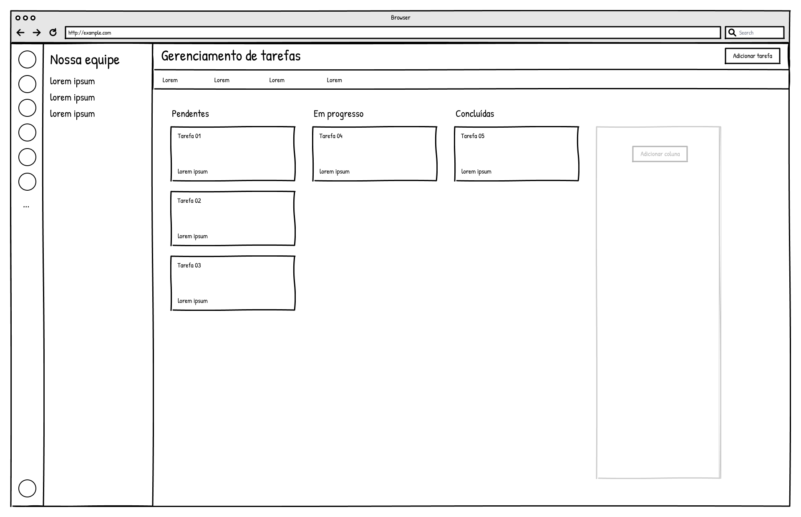
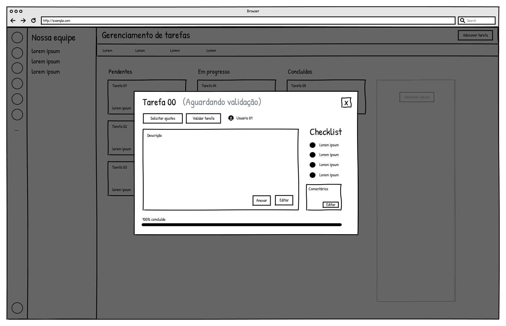

### 3.3.3 Processo 3 – Gerenciamento de Tarefas

O processo de gerenciamento de tarefas tem como objetivo organizar, distribuir e acompanhar as atividades realizadas por membros de uma equipe dentro de um projeto acadêmico, garantindo controle sobre responsabilidades, prazos e andamento das tarefas.

O processo inicia-se com o usuário acessando o sistema. Em seguida, o usuário realiza o login para entrar na aplicação. Após autenticado, o sistema apresenta a área de gerenciamento de tarefas. Ressalta-se que, em um cenário completo, o sistema pode disponibilizar diferentes módulos, como gerenciamento de equipes e projetos; no entanto, para fins desta modelagem, considera-se o acesso direto ao módulo de gerenciamento de tarefas, por se tratar do escopo específico deste processo.

A partir desse ponto, o usuário (líder da equipe) pode escolher entre visualizar tarefas existentes ou criar uma nova tarefa. Caso opte por criar uma tarefa, o usuário informa os dados necessários, como nome, descrição, responsável e prazo, e salva a tarefa, que passa a ficar disponível para execução.

Caso o usuário opte por visualizar tarefas, o sistema exibe a lista de tarefas existentes. A partir dessa visualização, o líder pode selecionar uma tarefa específica e decidir entre três ações distintas: editar a tarefa, excluir a tarefa ou validar tarefas concluídas.

Se optar por editar, o usuário altera as informações necessárias e salva as modificações. Se optar por excluir, o sistema solicita confirmação e, caso confirmada, a tarefa é removida. Se optar por validar tarefas, o sistema verifica se há tarefas concluídas e permite ao líder aprovar ou solicitar ajustes.

Paralelamente, o membro da equipe acessa o sistema, visualiza suas tarefas atribuídas e pode executá-las. Durante a execução, o membro pode atualizar o progresso da tarefa e, ao concluir, finalizá-la e enviá-la para validação.

Após o envio, o líder analisa a tarefa concluída. Caso esteja de acordo com os critérios estabelecidos, a tarefa é validada e o processo é encerrado para aquela tarefa. Caso contrário, o líder solicita ajustes, e a tarefa retorna ao membro para correção e nova submissão.

O processo se encerra quando a tarefa é validada ou excluída.

#### Modelo BPMN

#### Detalhamento das atividades

**01. Acessar sistema**

| **Campo**              | **Tipo**         | **Restrições**                          | **Valor default** |
|------------------------|------------------|------------------------------------------|-------------------|
| E-mail/Usuário        | Caixa de texto   | obrigatório; formato válido              |                   |
| Senha                 | Caixa de texto   | obrigatório                              |                   |

| **Comandos** | **Destino**        | **Tipo** |
|--------------|-------------------|----------|
| Entrar       | Visualizar tarefas| default  |
| Criar conta  | Cadastro          | default  |

**02. Cadastro**

| **Campo**              | **Tipo**         | **Restrições**                          | **Valor default** |
|------------------------|------------------|------------------------------------------|-------------------|
| Nome                  | Caixa de texto   | obrigatório                              |                   |
| Sobrenome             | Caixa de texto   | obrigatório                              |                   |
| E-mail                | Caixa de texto   | obrigatório; formato válido              |                   |
| Senha                 | Caixa de texto   | mínimo 6 caracteres                      |                   |
| Confirmar senha       | Caixa de texto   | deve ser igual à senha                   |                   |
| Aceitar termos        | Booleano         | obrigatório (true)                       | false             |

| **Comandos** | **Destino**         | **Tipo** |
|--------------|--------------------|----------|
| Criar conta  | Visualizar tarefas | default  |
| Cancelar     | Acessar sistema    | cancel   |

**03. Visualizar tarefas (acesso ao sistema)**

| **Campo**        | **Tipo**       | **Restrições**                         | **Valor default** |
|------------------|---------------|----------------------------------------|-------------------|
| Lista de tarefas | Tabela        | exibe tarefas do projeto do usuário    |                   |
| Status           | Seleção única | pendente / em progresso / concluída    | pendente          |

| **Comandos**       | **Destino**         | **Tipo** |
|--------------------|--------------------|----------|
| Abrir tarefa       | Visualizar tarefa  | default  |
| Adicionar tarefa   | Criar tarefa       | default  |

**04. Criar tarefa**

| **Campo**        | **Tipo**         | **Restrições**                                   | **Valor default** |
|------------------|------------------|--------------------------------------------------|-------------------|
| Nome da tarefa   | Caixa de texto   | 3 a 100 caracteres                               |                   |
| Descrição        | Área de texto    | até 500 caracteres                               |                   |
| Responsável      | Seleção única    | deve selecionar usuário válido do grupo          |                   |
| Prazo            | Data             | formato dd-mm-aaaa; data futura                  |                   |

| **Comandos** | **Destino**          | **Tipo** |
|--------------|---------------------|----------|
| Salvar       | Visualizar tarefas  | default  |
| Cancelar     | Visualizar tarefas  | cancel   |

**05. Visualizar tarefas**

| **Campo**        | **Tipo**       | **Restrições**                         | **Valor default** |
|------------------|---------------|----------------------------------------|-------------------|
| Lista de tarefas | Tabela        | exibe tarefas do projeto do usuário    |                   |
| Status           | Seleção única | pendente / em progresso / concluída    | pendente          |

| **Comandos**       | **Destino**         | **Tipo** |
|--------------------|--------------------|----------|
| Abrir tarefa       | Visualizar tarefa  | default  |
| Adicionar tarefa   | Criar tarefa       | default  |

**06. Visualizar tarefa**

| **Campo**        | **Tipo**         | **Restrições**                        | **Valor default** |
|------------------|------------------|---------------------------------------|-------------------|
| Nome da tarefa   | Caixa de texto   | somente leitura                      |                   |
| Descrição        | Área de texto    | até 500 caracteres                   |                   |
| Responsável      | Seleção única    | deve existir no grupo                |                   |
| Status           | Seleção única    | pendente / em progresso / concluída  |                   |

| **Comandos**          | **Destino**              | **Tipo** |
|-----------------------|--------------------------|----------|
| Executar tarefa       | Executar tarefa          | default  |
| Validar tarefa        | Validar tarefas          | default  |
| Mover para lixeira    | Excluir tarefa           | default  |
| Fechar                | Visualizar tarefas       | cancel   |

**07. Executar tarefa**

| **Campo**        | **Tipo**         | **Restrições**                        | **Valor default** |
|------------------|------------------|---------------------------------------|-------------------|
| Progresso        | Número           | 0 a 100 (%)                          | 0                 |
| Comentário       | Área de texto    | até 300 caracteres                   |                   |
| Anexos           | Arquivo          | formatos: pdf, jpg, png; máx 5MB     |                   |

| **Comandos**             | **Destino**                 | **Tipo** |
|--------------------------|-----------------------------|----------|
| Atualizar progresso      | Atualizar progresso         | default  |
| Finalizar tarefa         | Enviar para validação       | default  |
| Cancelar                 | Visualizar tarefa           | cancel   |

**08. Atualizar progresso**

| **Campo**  | **Tipo** | **Restrições** | **Valor default** |
|------------|----------|----------------|-------------------|
| Progresso  | Número   | 0 a 100 (%)    |                   |

| **Comandos** | **Destino**        | **Tipo** |
|--------------|-------------------|----------|
| Salvar       | Executar tarefa   | default  |

**09. Enviar para validação**

| **Comandos** | **Destino**        | **Tipo** |
|--------------|-------------------|----------|
| Confirmar    | Validar tarefas   | default  |

**10. Validar tarefas**

| **Campo**  | **Tipo**         | **Restrições**         | **Valor default** |
|------------|------------------|------------------------|-------------------|
| Status     | Seleção única    | aprovado / reprovado   |                   |
| Comentário | Área de texto    | até 300 caracteres     |                   |

| **Comandos**       | **Destino**                     | **Tipo** |
|--------------------|--------------------------------|----------|
| Aprovar            | Fim (tarefa validada)          | default  |
| Solicitar ajustes  | Ajustar tarefa                 | default  |

**11. Excluir tarefa**

| **Campo**     | **Tipo** | **Restrições** | **Valor default** |
|---------------|----------|----------------|-------------------|
| Confirmação   | Booleano | true / false   | false             |

| **Comandos** | **Destino**              | **Tipo** |
|--------------|--------------------------|----------|
| Confirmar    | Fim (tarefa excluída)    | default  |
| Cancelar     | Visualizar tarefa        | cancel   |

**Wireframe**

