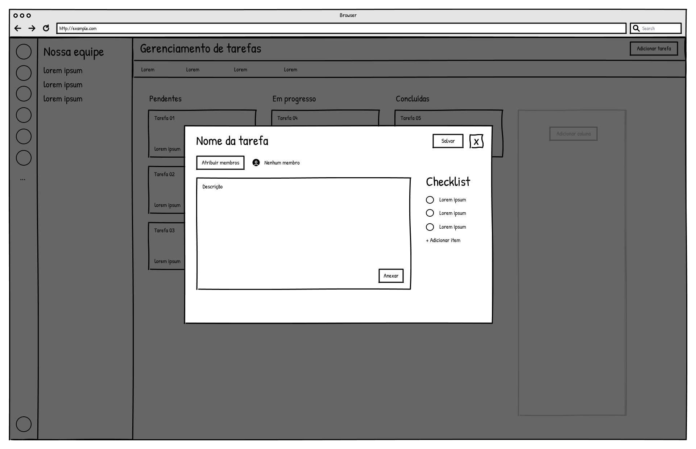
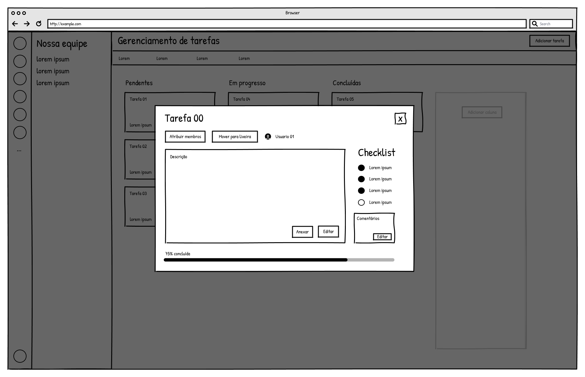
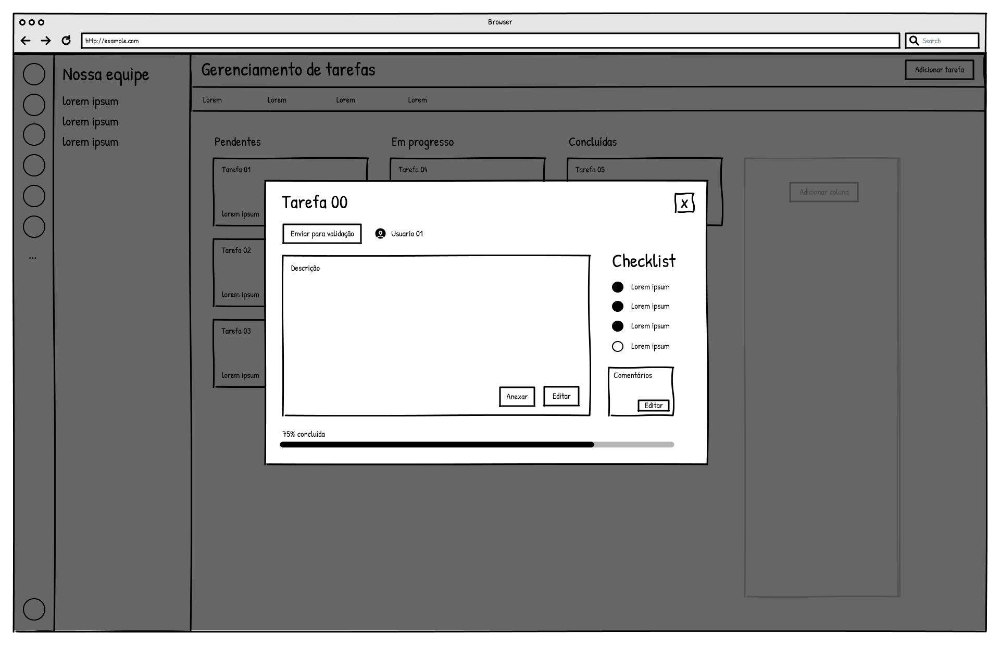
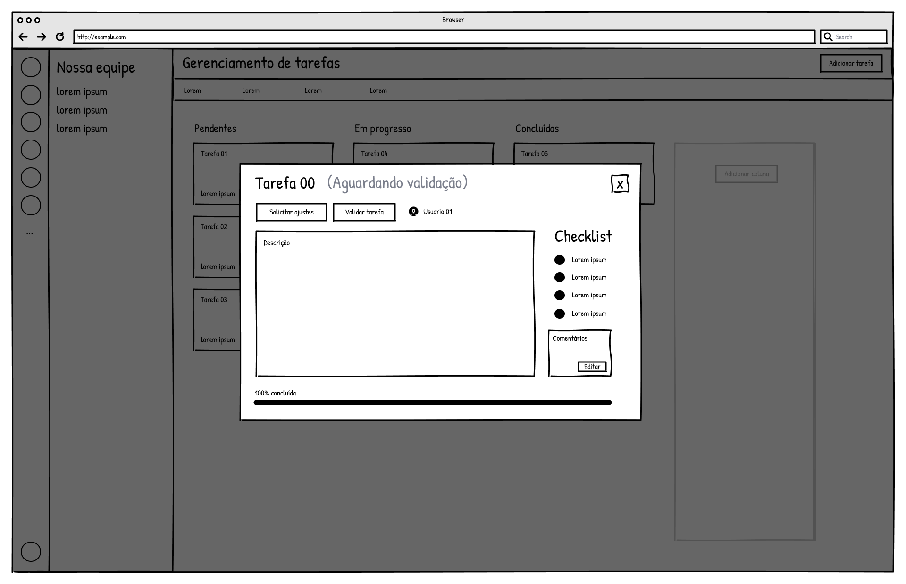

### 3.3.3 Processo 3 – Gerenciamento de Tarefas

O processo de Gerenciamento de Tarefas tem como objetivo organizar, distribuir e acompanhar as atividades realizadas por membros de uma equipe dentro de um projeto acadêmico, garantindo controle sobre responsabilidades, prazos e andamento das tarefas.

O processo inicia-se com o usuário acessando o sistema. Em seguida, o usuário realiza o login para entrar na aplicação. Após autenticado, o sistema apresenta a área de gerenciamento de tarefas. Ressalta-se que, em um cenário completo, o sistema pode disponibilizar diferentes módulos, como gerenciamento de equipes e projetos; no entanto, para fins desta modelagem, considera-se o acesso direto ao módulo de gerenciamento de tarefas, por se tratar do escopo específico deste processo.

A partir desse ponto, o usuário (líder da equipe) pode escolher entre visualizar tarefas existentes ou criar uma nova tarefa. Caso opte por criar uma tarefa, o usuário informa os dados necessários, como nome, descrição, responsável e prazo, e salva a tarefa, que passa a ficar disponível para execução.

Caso o usuário opte por visualizar tarefas, o sistema exibe a lista de tarefas existentes. A partir dessa visualização, o líder pode selecionar uma tarefa específica e decidir entre três ações distintas: editar a tarefa, excluir a tarefa ou validar tarefas concluídas.

Se optar por editar, o usuário altera as informações necessárias e salva as modificações. Se optar por excluir, o sistema solicita confirmação e, caso confirmada, a tarefa é removida. Se optar por validar tarefas, o sistema verifica se há tarefas concluídas e permite ao líder aprovar ou solicitar ajustes.

Paralelamente, o membro da equipe acessa o sistema, visualiza suas tarefas atribuídas e pode executá-las. Durante a execução, o membro pode atualizar o progresso da tarefa e, ao concluir, finalizá-la e enviá-la para validação.

Após o envio, o líder analisa a tarefa concluída. Caso esteja de acordo com os critérios estabelecidos, a tarefa é validada e o processo é encerrado para aquela tarefa. Caso contrário, o líder solicita ajustes, e a tarefa retorna ao membro para correção e nova submissão.

O processo se encerra quando a tarefa é validada ou excluída.

#### Modelo BPMN

#### Detalhamento das atividades

As tabelas e colunas aparecem entre crases para facilitar a conferência no banco de dados.

**01. Acessar sistema - tabela `usuario`**

| **Campo no banco** | **Tipo** | **Restrições** | **Valor default** |
|--------------------|----------|----------------|-------------------|
| `email`            | Texto    | obrigatório; usuário deve estar cadastrado | |
| `senha`            | Texto    | obrigatório; deve corresponder ao usuário | |

| **Comandos** | **Destino** | **Tipo** |
|--------------|-------------|----------|
| Entrar | Visualizar tarefas | default |
| Criar conta | Cadastro | default |

**02. Cadastro - tabela `usuario`**

| **Campo no banco** | **Tipo** | **Restrições** | **Valor default** |
|--------------------|----------|----------------|-------------------|
| `id`               | Número   | gerado automaticamente | |
| `nome`             | Texto    | obrigatório; até 100 caracteres | |
| `sobrenome`        | Texto    | obrigatório; até 100 caracteres | |
| `email`            | Texto    | obrigatório; formato válido; único; até 150 caracteres | |
| `senha`            | Texto    | obrigatório; 6 a 255 caracteres | |

| **Comandos** | **Destino** | **Tipo** |
|--------------|-------------|----------|
| Criar conta | Visualizar tarefas | default |
| Cancelar | Acessar sistema | cancel |

**03. Visualizar tarefas - tabela `tarefa`**

| **Campo no banco** | **Tipo** | **Restrições** | **Valor default** |
|--------------------|----------|----------------|-------------------|
| `projeto_id`       | Número   | lista somente tarefas do projeto atual | |
| `nome`             | Texto    | nome apresentado no quadro | |
| `coluna`           | Texto    | coluna do quadro onde a tarefa aparece | `A fazer` |
| `status`           | Texto    | valores `PENDENTE`, `EM_ANDAMENTO`, `EM_VALIDACAO`, `APROVADA` ou `AJUSTES` | `PENDENTE` |
| `excluida`         | Booleano | tarefas com valor `true` aparecem na lixeira | `false` |

| **Comandos** | **Destino** | **Tipo** |
|--------------|-------------|----------|
| Abrir tarefa | Visualizar ou editar tarefa | default |
| Adicionar tarefa | Criar tarefa | default |
| Mover para lixeira | Lixeira de tarefas | default |

**04. Criar tarefa - tabela `tarefa`**

| **Campo no banco** | **Tipo** | **Restrições** | **Valor default** |
|--------------------|----------|----------------|-------------------|
| `projeto_id`       | Número   | identifica o projeto atual | |
| `nome`             | Texto    | obrigatório; 3 a 100 caracteres | |
| `descricao`        | Texto    | opcional; até 500 caracteres | |
| `responsavel`      | Texto    | opcional; armazena os membros atribuídos | |
| `coluna`           | Texto    | opcional; até 80 caracteres | `A fazer` |
| `prazo`            | Data     | opcional | |
| `hora_prazo`       | Texto    | opcional; até 5 caracteres | |
| `comentario`       | Texto    | opcional; até 5000 caracteres | |
| `checklist`        | Texto    | opcional; até 5000 caracteres | |
| `anexo`            | Texto    | opcional; armazena os anexos | |
| `progresso`        | Número   | calculado automaticamente a partir do checklist | `0` |
| `status`           | Texto    | situação inicial da tarefa | `PENDENTE` |
| `excluida`         | Booleano | indica se a tarefa está na lixeira | `false` |

| **Comandos** | **Destino** | **Tipo** |
|--------------|-------------|----------|
| Salvar | Visualizar tarefas | default |
| Cancelar | Visualizar tarefas | cancel |

**05. Visualizar ou editar tarefa - tabela `tarefa`**

| **Campo no banco** | **Tipo** | **Restrições** | **Valor default** |
|--------------------|----------|----------------|-------------------|
| `nome`             | Texto    | obrigatório; 3 a 100 caracteres | valor atual |
| `descricao`        | Texto    | opcional; até 500 caracteres | valor atual |
| `responsavel`      | Texto    | opcional; armazena os membros atribuídos | valor atual |
| `coluna`           | Texto    | até 80 caracteres | valor atual |
| `prazo`            | Data     | opcional | valor atual |
| `hora_prazo`       | Texto    | opcional; até 5 caracteres | valor atual |
| `comentario`       | Texto    | opcional; até 5000 caracteres | valor atual |
| `checklist`        | Texto    | opcional; até 5000 caracteres | valor atual |
| `anexo`            | Texto    | opcional; armazena os anexos | valor atual |
| `progresso`        | Número   | recalculado automaticamente a partir do checklist | valor atual |
| `status`           | Texto    | situação atual da tarefa | valor atual |

| **Comandos** | **Destino** | **Tipo** |
|--------------|-------------|----------|
| Salvar alterações | Visualizar tarefas | default |
| Enviar para validação | Validação da tarefa | default |
| Mover para lixeira | Lixeira de tarefas | default |
| Fechar | Visualizar tarefas | cancel |

**06. Mover tarefa para a lixeira - tabela `tarefa`**

| **Campo no banco** | **Tipo** | **Restrições** | **Valor default** |
|--------------------|----------|----------------|-------------------|
| `excluida`         | Booleano | o registro continua no banco enquanto estiver na lixeira | `true` |

| **Comandos** | **Destino** | **Tipo** |
|--------------|-------------|----------|
| Mover para lixeira | Lixeira de tarefas | default |
| Restaurar | Visualizar tarefas | default |
| Excluir definitivamente | Fim do processo da tarefa | default |

Ao restaurar uma tarefa, `excluida` volta para `false`. Ao excluir definitivamente, o registro é removido da tabela `tarefa`.

**07. Executar tarefa e enviar para validação - tabela `tarefa`**

| **Campo no banco** | **Tipo** | **Restrições** | **Valor default** |
|--------------------|----------|----------------|-------------------|
| `checklist`        | Texto    | registra os itens marcados pelo membro | valor atual |
| `progresso`        | Número   | calculado automaticamente a partir do checklist | valor atual |
| `comentario`       | Texto    | registra comentários e o envio para validação | valor atual |
| `anexo`            | Texto    | opcional; armazena os anexos | valor atual |
| `status`           | Texto    | passa para `EM_VALIDACAO` ao enviar | `EM_VALIDACAO` |

| **Comandos** | **Destino** | **Tipo** |
|--------------|-------------|----------|
| Enviar para validação | Validar tarefa | default |
| Fechar | Visualizar tarefas | cancel |

**08. Validar tarefa - tabela `tarefa`**

| **Campo no banco** | **Tipo** | **Restrições** | **Valor default** |
|--------------------|----------|----------------|-------------------|
| `status`           | Texto    | passa para `APROVADA` ou `AJUSTES`; uma tarefa aprovada também pode ser reaberta como `EM_ANDAMENTO` | valor atual |
| `comentario`       | Texto    | registra aprovação ou ajustes solicitados | valor atual |

| **Comandos** | **Destino** | **Tipo** |
|--------------|-------------|----------|
| Aprovar tarefa | Fim do processo da tarefa | default |
| Solicitar ajustes | Executar tarefa | default |
| Reabrir tarefa | Executar tarefa | default |

