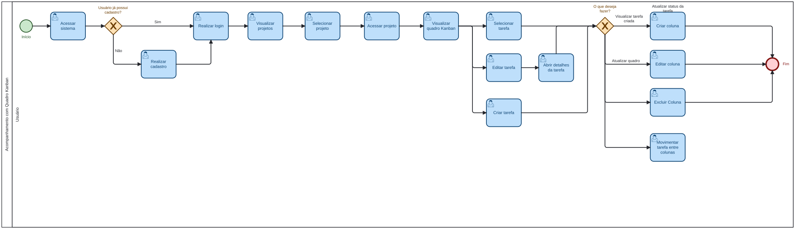

### 3.3.4 Processo 4 – Quadro Kanban

O processo do Quadro Kanban oferece uma visualização visual das tarefas criadas organizando-as em colunas que representam estágios de progresso. O quadro permite o acompanhamento e o andamento das atividades de forma clara.

Como oportunidade de melhoria temos a possibilidade de personalização do fluxo de trabalho, com colunas customizáveis que se adaptam à dinâmica de cada grupo. Além disso, o processo centraliza a visualização do progresso do projeto em um único painel, reduzindo a necessidade de comunicação manual sobre o status das tarefas aumentando assim a transparência entre os membros.

#### Modelo BPMN

#### Detalhamento das atividades

_Os tipos de dados a serem utilizados são:_

**Área de texto** - campo texto de múltiplas linhas  
**Caixa de texto** - campo texto de uma linha
**Data** - campo do tipo data (dd-mm-aaaa) 
**Hora** - campo do tipo hora (hh:mm:ss)  
**Data e Hora** - campo do tipo data e hora (dd-mm-aaaa, hh:mm:ss)  
**Imagem** - campo contendo uma imagem 
**Arquivo** - campo de upload de documento  
**Link** - campo que armazena uma URL 

**01. Visualizar quadro**

| **Campo**         | **Tipo** | **Restrições**                                              | **Valor default**       |
| ---               | ---      | ---                                                         | ---                     |
| Colunas           | Tabela   | exibe colunas do projeto; mínimo 1 coluna                   |                         |
| Cards de tarefas  | Tabela   | exibe tarefas do Processo 3 agrupadas por coluna/status     |                         |
| Filtro de membro  | Seleção única | filtra cards por responsável; deve ser membro do grupo |                         |
| Filtro de prazo   | Seleção única | hoje / esta semana / atrasadas / todas                 | todas                   |

| **Comandos**         | **Destino**             | **Tipo**  |
| ---                  | ---                     | ---       |
| Adicionar coluna     | Criar coluna            | default   |
| Mover card           | Mover card              | default   |
| Abrir card           | Visualizar card         | default   |
| Editar coluna        | Editar coluna           | default   |
| Excluir coluna       | Excluir coluna          | default   |

---

**02. Criar coluna**

| **Campo**      | **Tipo**       | **Restrições**                                        | **Valor default** |
| ---            | ---            | ---                                                   | ---               |
| Nome           | Caixa de texto | 2 a 50 caracteres; não pode duplicar nome existente   |                   |
| Cor            | Seleção única  | paleta predefinida de cores                           | cinza             |

| **Comandos** | **Destino**      | **Tipo**  |
| ---          | ---              | ---       |
| Salvar       | Visualizar quadro | default  |
| Cancelar     | Visualizar quadro | cancel   |

---

**03. Editar coluna**

| **Campo**      | **Tipo**       | **Restrições**                                        | **Valor default**        |
| ---            | ---            | ---                                                   | ---                      |
| Nome           | Caixa de texto | 2 a 50 caracteres; não pode duplicar nome existente   | nome atual da coluna     |
| Cor            | Seleção única  | paleta predefinida de cores                           | cor atual da coluna      |
| Posição        | Número         | inteiro positivo; reordena a coluna no quadro         | posição atual da coluna  |

| **Comandos** | **Destino**       | **Tipo**  |
| ---          | ---               | ---       |
| Salvar       | Visualizar quadro | default   |
| Cancelar     | Visualizar quadro | cancel    |

---

**04. Excluir coluna**

| **Campo**     | **Tipo** | **Restrições**                                                                      | **Valor default** |
| ---           | ---      | ---                                                                                 | ---               |
| Confirmação   | Booleano | true / false; se a coluna possuir cards, exige confirmação explícita do usuário     | false             |

| **Comandos** | **Destino**                    | **Tipo**  |
| ---          | ---                            | ---       |
| Confirmar    | Visualizar quadro              | default   |
| Cancelar     | Visualizar quadro              | cancel    |

---

**05. Mover card**

| **Campo**          | **Tipo**      | **Restrições**                                                              | **Valor default**      |
| ---                | ---           | ---                                                                         | ---                    |
| Card selecionado   | Seleção única | deve ser uma tarefa válida do projeto                                       |                        |
| Coluna de destino  | Seleção única | deve ser uma coluna existente no quadro; não pode ser a coluna de origem    |                        |

| **Comandos**   | **Destino**       | **Tipo**  |
| ---            | ---               | ---       |
| Confirmar      | Visualizar quadro | default   |
| Cancelar       | Visualizar quadro | cancel    |

---

**06. Visualizar card**

| **Campo**        | **Tipo**       | **Restrições**                        | **Valor default** |
| ---              | ---            | ---                                   | ---               |
| Nome da tarefa   | Caixa de texto | somente leitura                       |                   |
| Descrição        | Área de texto  | somente leitura                       |                   |
| Responsável      | Seleção única  | somente leitura                       |                   |
| Prazo            | Data           | somente leitura; formato dd-mm-aaaa   |                   |
| Status           | Seleção única  | somente leitura; espelha coluna atual |                   |
| Progresso        | Número         | somente leitura; 0 a 100 (%)          |                   |

| **Comandos**       | **Destino**             | **Tipo**  |
| ---                | ---                     | ---       |
| Abrir tarefa       | Visualizar tarefa (Processo 3) | default |
| Fechar             | Visualizar quadro       | cancel    |

---

**Wireframe**

