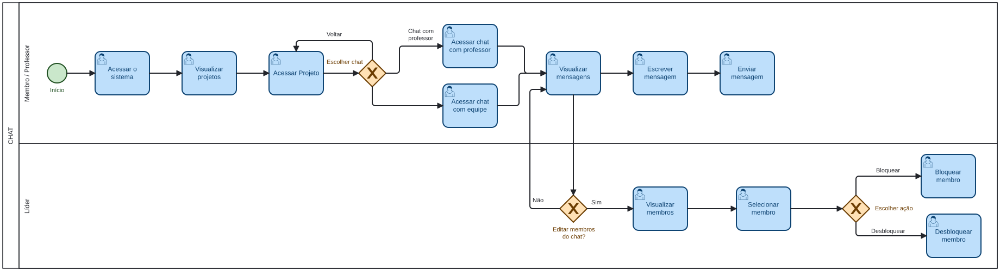
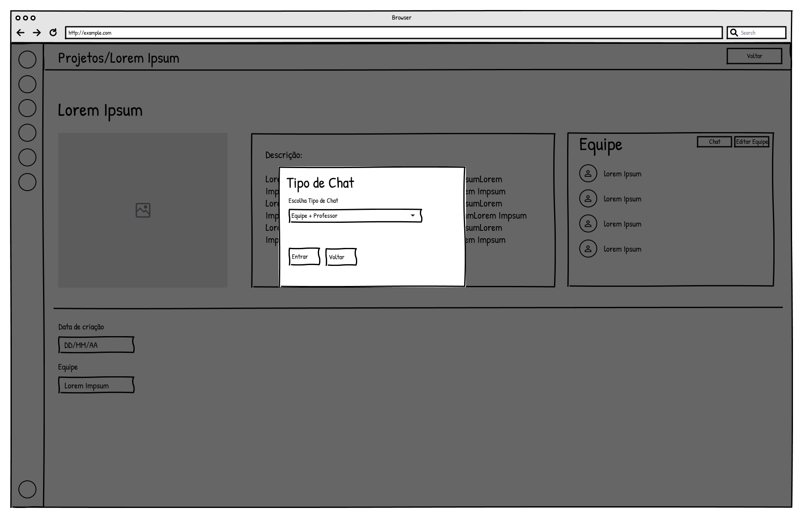
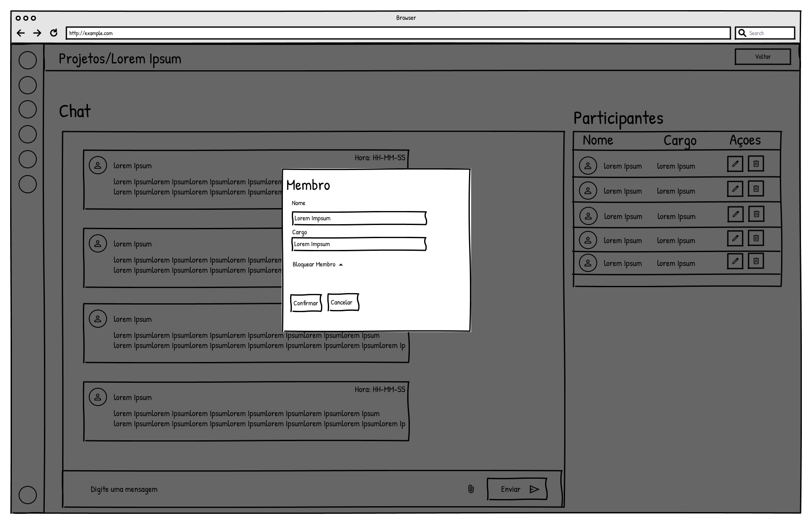
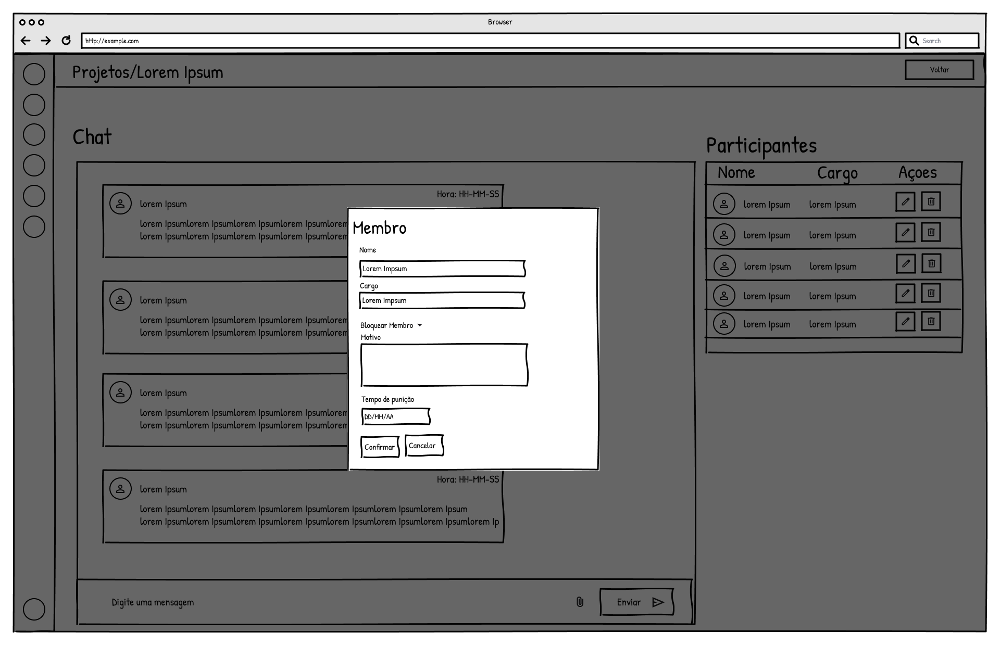
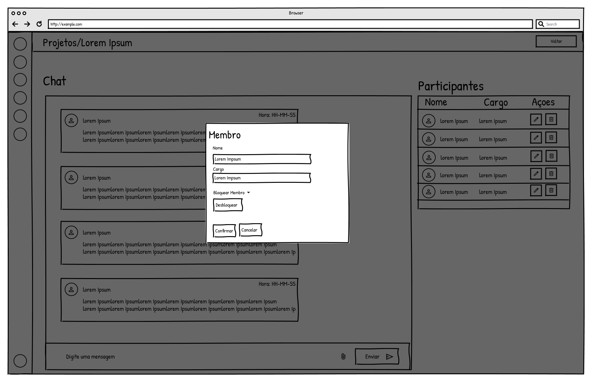

### 3.3.4 Processo 4 – Chat

O processo de Chat tem como objetivo centralizar a comunicação entre os membros da equipe e, quando necessário, com o professor, proporcionando um canal direto e organizado para troca de mensagens no contexto do projeto. Por meio dele, os usuários podem compartilhar informações, esclarecer dúvidas e alinhar atividades de forma rápida, sem depender de ferramentas externas.

#### Modelo BPMN

#### Detalhamento das atividades

**01. Acessar chat da equipe**

| **Campo**            | **Tipo**         | **Restrições**                          | **Valor default** |
|----------------------|------------------|-----------------------------------------|-------------------|
| Projeto              | Texto            | obrigatório; contexto do usuário        |                   |
| Tipo de Chat         | Seleção única    | equipe / equipe + professor             | equipe            |
| Usuário              | Texto            | autenticado                             |                   |

| **Comandos** | **Destino**           | **Tipo** |
|--------------|----------------------|----------|
| Entrar       | Visualizar chat      | default  |
| Voltar       | Fim                  | cancel   |

**01.1 Wireframe**

**01.2 Wireframe**

**02. Visualizar chat**

| **Campo**            | **Tipo**        | **Restrições**                          | **Valor default** |
|----------------------|-----------------|-----------------------------------------|-------------------|
| Lista de Mensagens   | Tabela/Feed     | ordenação por data/hora                 |                   |
| Participantes        | Lista           | membros da equipe/chat                  |                   |
| Status do Usuário    | Texto           | ativo / bloqueado                       | ativo             |

| **Comandos**        | **Destino**         | **Tipo** |
|---------------------|--------------------|----------|
| Enviar mensagem     | Enviar mensagem    | default  |
| Bloquear membro     | Bloquear membro    | default  |
| Desbloquear membro  | Desbloquear membro | default  |
| Sair                | Fim                | default  |

**02.1 Wireframe**

**03. Enviar mensagem**

| **Campo**            | **Tipo**         | **Restrições**                          | **Valor default** |
|----------------------|------------------|-----------------------------------------|-------------------|
| Conteúdo             | Área de texto    | obrigatório; até 1000 caracteres        |                   |
| Anexo                | Upload           | opcional                                |                   |

| **Comandos** | **Destino**         | **Tipo** |
|--------------|--------------------|----------|
| Enviar       | Atualizar chat     | default  |
| Cancelar     | Visualizar chat    | cancel   |

**03.1 Wireframe**

**04. Bloquear membro**

| **Campo**            | **Tipo**         | **Restrições**                  | **Valor default** |
|----------------------|------------------|---------------------------------|-------------------|
| Membro               | Seleção única    | obrigatório                     |                   |
| Motivo               | Área de texto    | opcional                        |                   |
| Tempo de bloqueio    | Seleção única    | temporário / permanente         | temporário        |

| **Comandos** | **Destino**      | **Tipo** |
|--------------|-----------------|----------|
| Confirmar    | Atualizar chat  | default  |
| Cancelar     | Visualizar chat | cancel   |

**04.1 Wireframe**

**04.2 Wireframe**

**05. Desbloquear membro**

| **Campo**        | **Tipo**         | **Restrições** | **Valor default** |
|------------------|------------------|----------------|-------------------|
| Membro           | Seleção única    | obrigatório    |                   |

| **Comandos** | **Destino**      | **Tipo** |
|--------------|-----------------|----------|
| Confirmar    | Atualizar chat  | default  |
| Cancelar     | Visualizar chat | cancel   |

**05    .1 Wireframe**

