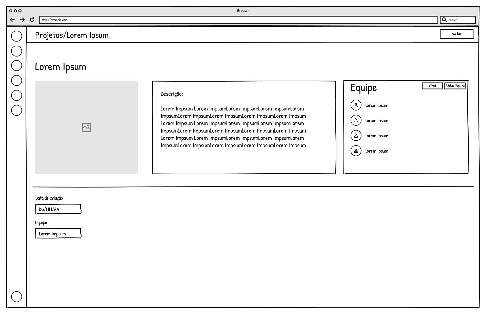
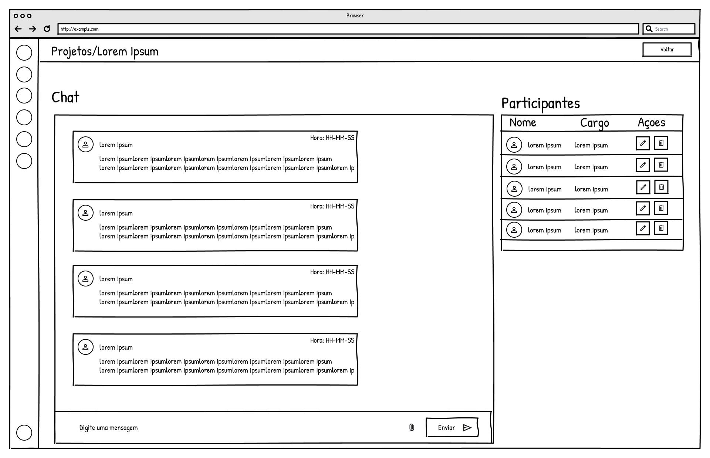

### 3.3.4 Processo 4 – Comunicação da equipe

O processo de Comunicação da Equipe tem como objetivo centralizar a troca de mensagens relacionadas aos projetos acadêmicos e permitir conversas privadas entre os usuários. O fluxo começa com o acesso ao sistema. Caso o usuário ainda não possua cadastro, deve criar uma conta e realizar o login antes de abrir a área de chats.

Após a autenticação, o usuário visualiza sua lista de conversas. Nessa tela, pode selecionar o chat de uma equipe da qual participa ou iniciar uma conversa privada informando o e-mail de outro usuário cadastrado. Ao abrir uma conversa, o sistema registra a leitura na tabela chat_leitura e apresenta as mensagens armazenadas em chat_mensagem. Caso o usuário já tenha saído de um projeto, o chat da equipe continua disponível apenas para consulta do histórico.

Quando a conversa permite interação, o usuário pode escrever uma mensagem e incluir anexos. A mensagem é salva em chat_mensagem. Se o envio ocorrer em uma conversa privada, o sistema também cria uma linha na tabela notificacao para avisar o destinatário. O usuário pode editar suas próprias mensagens, preservando o conteúdo anterior, ou realizar a exclusão lógica, mantendo o registro no banco com a indicação de mensagem excluída.

Por fim, o usuário pode ocultar uma conversa privada da própria lista. O mesmo pode ser feito com um chat de equipe após a saída do projeto. Nesse caso, o sistema registra a ação em chat_oculto sem apagar as mensagens do banco de dados. O processo termina quando o usuário encerra a consulta ou oculta a conversa.

#### Modelo BPMN

#### Detalhamento das atividades

Os campos abaixo são apenas os que aparecem nas telas do processo. A coluna de origem indica onde a informação pode ser conferida no banco.

**01. Acessar chat da equipe ou conversa privada**

| **Campo visível na tela** | **Origem no banco** | **Onde aparece** |
|---------------------------|---------------------|------------------|
| Nome do projeto | projeto.nome_projeto | lista de chats de equipe |
| Nome do contato | usuario.nome e usuario.sobrenome | lista de conversas privadas |
| E-mail do contato | usuario.email | nova conversa e lista de membros |
| Foto ou avatar | usuario.foto_url | lista de chats e membros |
| Prévia da última mensagem | chat_mensagem.conteudo | lista de chats |
| Indicação de não lida | chat_leitura.visualizado_ate | lista de chats |
| Status somente leitura | membro_equipe.data_saida | chat de equipe após saída |

| **Comandos** | **Destino** | **Tipo** |
|--------------|-------------|----------|
| Entrar no chat da equipe | Visualizar chat | default |
| Iniciar conversa privada | Visualizar chat | default |
| Voltar | Fim | cancel |

**02. Visualizar chat**

| **Campo visível na tela** | **Origem no banco** | **Onde aparece** |
|---------------------------|---------------------|------------------|
| Nome da conversa | projeto.nome_projeto ou usuario.nome | topo do chat |
| Quantidade de participantes | membro_equipe | topo do chat de equipe |
| Nome do autor | chat_mensagem.autor_nome ou chat_mensagem.autor_email | mensagem |
| Horário da mensagem | chat_mensagem.data_hora | mensagem |
| Texto da mensagem | chat_mensagem.conteudo | mensagem |
| Anexo | chat_mensagem.anexo | mensagem |
| Indicação de mensagem editada | chat_mensagem.editada | mensagem própria ou recebida |
| Mensagem excluída | chat_mensagem.conteudo | mensagem removida logicamente |

| **Comandos** | **Destino** | **Tipo** |
|--------------|-------------|----------|
| Enviar mensagem | Atualizar chat | default |
| Editar mensagem própria | Editar mensagem | default |
| Excluir mensagem própria | Excluir mensagem | default |
| Ocultar conversa | Ocultar conversa da lista | default |
| Apenas visualizar | Fim | default |

**03. Enviar mensagem**

| **Campo visível na tela** | **Origem no banco** | **Onde aparece** |
|---------------------------|---------------------|------------------|
| Mensagem digitada | chat_mensagem.conteudo | campo de mensagem |
| Anexo selecionado | chat_mensagem.anexo | área de anexos |

| **Comandos** | **Destino** | **Tipo** |
|--------------|-------------|----------|
| Enviar | Atualizar chat | default |
| Cancelar | Visualizar chat | cancel |

**04. Editar mensagem própria**

| **Campo visível na tela** | **Origem no banco** | **Onde aparece** |
|---------------------------|---------------------|------------------|
| Texto da mensagem | chat_mensagem.conteudo | modal de edição |
| Anexo da mensagem | chat_mensagem.anexo | modal de edição |

| **Comandos** | **Destino** | **Tipo** |
|--------------|-------------|----------|
| Salvar alteração | Atualizar chat | default |
| Cancelar | Visualizar chat | cancel |

**05. Excluir mensagem própria**

| **Campo visível na tela** | **Origem no banco** | **Onde aparece** |
|---------------------------|---------------------|------------------|
| Texto da mensagem | chat_mensagem.conteudo | mensagem selecionada |
| Confirmação de exclusão | tela de confirmação | modal de exclusão |

| **Comandos** | **Destino** | **Tipo** |
|--------------|-------------|----------|
| Confirmar | Atualizar chat | default |
| Cancelar | Visualizar chat | cancel |

**06. Ocultar conversa da lista**

| **Campo visível na tela** | **Origem no banco** | **Onde aparece** |
|---------------------------|---------------------|------------------|
| Nome da conversa | projeto.nome_projeto ou usuario.nome | topo do chat |
| Confirmação de exclusão do chat | tela de confirmação | modal de exclusão do chat |

| **Comandos** | **Destino** | **Tipo** |
|--------------|-------------|----------|
| Ocultar conversa | Fim | default |
| Cancelar | Visualizar chat | cancel |
