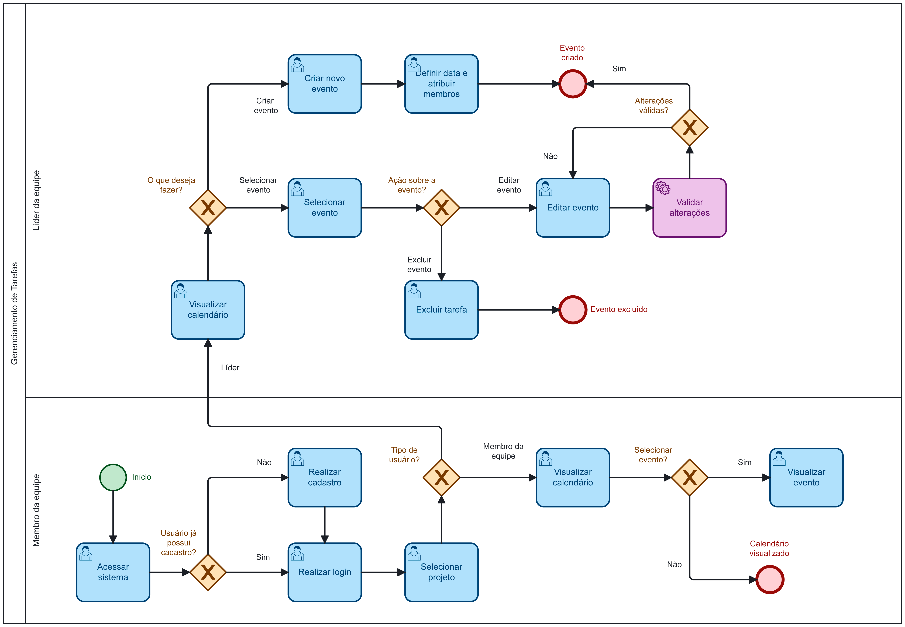
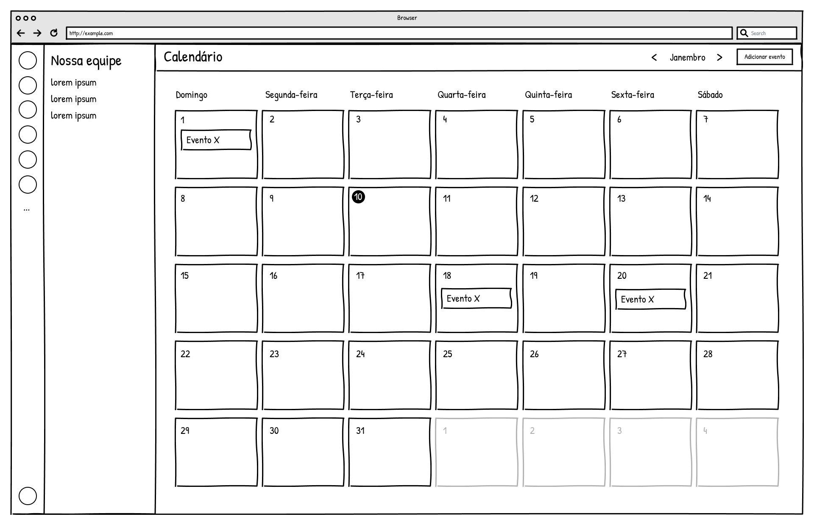
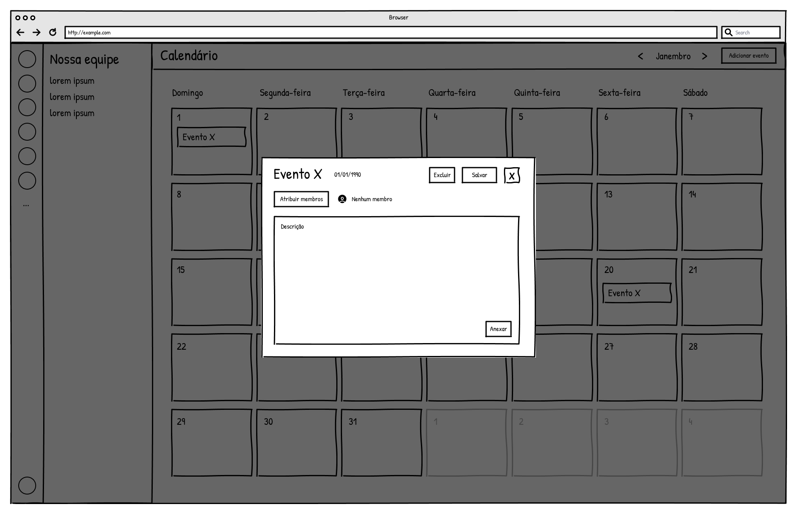
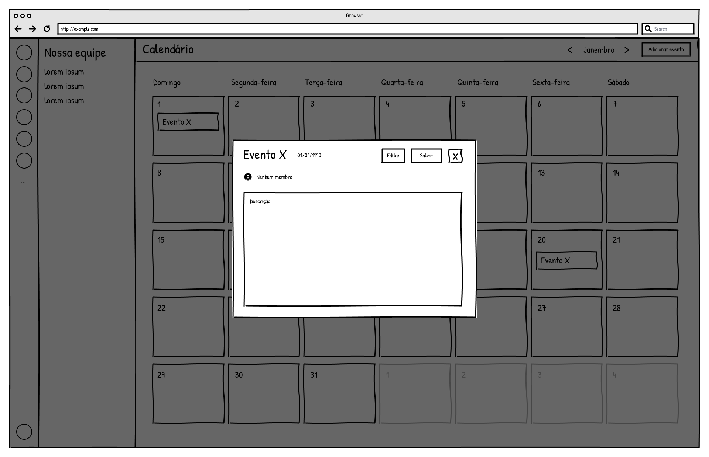
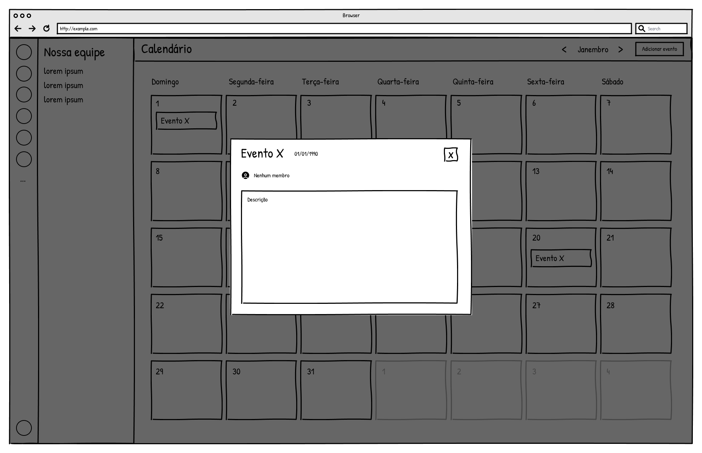

### 3.3.5 Processo 5 – Gestão de Cronograma e Prazos

O processo de Gestão de Cronograma e Prazos tem como objetivo permitir o planejamento, a organização e o acompanhamento temporal das atividades relacionadas aos projetos acadêmicos. Por meio de um painel de controle, o usuário tem acesso a um calendário que centraliza eventos cadastrados e tarefas dos projetos, possibilitando uma visão integrada das responsabilidades e dos prazos.

O fluxo tem início com o acesso do usuário ao sistema, sendo necessário realizar o login ou, caso ainda não possua cadastro, efetuar o registro informando os dados solicitados. Após a autenticação, o usuário acessa o painel de controle, onde é apresentado o calendário com os eventos previamente cadastrados.

Nesse ambiente, o usuário pode interagir com o calendário realizando diferentes ações. É possível adicionar novos eventos, informando dados como título, descrição, data e horário. Além disso, o sistema permite visualizar os detalhes de eventos e tarefas ao selecioná-los no calendário. Também é possível editar eventos existentes, atualizando suas informações, ou excluí-los mediante confirmação.

Adicionalmente, as tarefas cadastradas nos projetos são exibidas automaticamente no calendário com base em seus respectivos prazos, permitindo uma visualização consolidada das atividades e facilitando o acompanhamento do cronograma.

Como oportunidade de melhoria, destaca-se a centralização das informações temporais em um único ambiente, o que contribui para uma melhor organização, redução de esquecimentos e maior controle sobre os prazos das atividades acadêmicas.

#### Modelo BPMN

#### Detalhamento das atividades

**01. Atividade 1**
## 01. Visualizar eventos no calendário (grade principal)

| Campo / Elemento          | Tipo          | Restrições                                           | Valor default          |
| ------------------------- | ------------- | ---------------------------------------------------- | ---------------------- |
| Mês/Ano                   | Texto         | somente leitura; alterado via navegação             | mês atual              |
| Grade do calendário       | Visual (grid) | exibe dias do mês + dias adjacentes (cinza)         |                        |
| Dias da semana            | Texto         | fixo (Domingo a Sábado)                             |                        |
| Eventos (dentro do dia)   | Tag/Label     | exibidos com nome do evento                         |                        |
| Equipe (menu lateral)     | Lista         | exibe equipes disponíveis                           |                        |

| Comando                   | Destino                  | Tipo                   |
| ------------------------- | ------------------------ | ---------------------- |
| < (mês anterior)          | Atualizar calendário     | default                |
| > (próximo mês)           | Atualizar calendário     | default                |
| Clique em um evento       | Abrir modal edição/visualização | default          |
| Clique em um dia vazio    | Abrir modal criar evento | default                |
| Selecionar dia (área do dia) | Exibir eventos do dia em lista (opcional) | default |

## 02. Criar evento (modal ou página)

| Campo               | Tipo           | Restrições                                           | Valor default          |
| ------------------- | -------------- | ---------------------------------------------------- | ---------------------- |
| Nome do Evento      | Caixa de texto | obrigatório, máximo 100 caracteres                  | (vazio)                |
| Data                | Seletor de data| obrigatório; deve ser uma data válida               | dia selecionado no calendário |
| Membros             | Lista múltipla | opcional; exibe membros da equipe                   | nenhum selecionado     |
| Descrição           | Área de texto  | opcional; limite 500 caracteres                     | (vazio)                |

| Comando             | Destino                  | Tipo                   |
| ------------------- | ------------------------ | ---------------------- |
| Salvar              | Criar evento e atualizar calendário | default       |
| Cancelar            | Fechar modal / voltar ao calendário | cancel        |
| X (fechar)          | Fechar modal sem salvar  | cancel                 |

## 03. Editar evento (modal ou página)

| Campo               | Tipo           | Restrições                                           | Valor default          |
| ------------------- | -------------- | ---------------------------------------------------- | ---------------------- |
| Nome do Evento      | Caixa de texto | obrigatório, máximo 100 caracteres                  | valor atual do evento  |
| Data                | Seletor de data| obrigatório                                         | data atual do evento   |
| Membros             | Lista múltipla | opcional; exibe membros da equipe                   | membros atuais do evento |
| Descrição           | Área de texto  | opcional; limite 500 caracteres                     | descrição atual        |

| Comando             | Destino                  | Tipo                   |
| ------------------- | ------------------------ | ---------------------- |
| Salvar alterações   | Atualizar evento e calendário | default           |
| Excluir             | Abrir modal de confirmação de exclusão | perigo (destacado) |
| Cancelar            | Fechar modal sem salvar  | cancel                 |
| X (fechar)          | Fechar modal sem salvar  | cancel                 |

## 04. Excluir evento (modal de confirmação)

| Campo / Elemento     | Tipo          | Restrições                                           | Valor default          |
| -------------------- | ------------- | ---------------------------------------------------- | ---------------------- |
| Mensagem de confirmação | Texto     | somente leitura; "Deseja realmente excluir o evento [nome do evento]?" | baseado no evento selecionado |

| Comando             | Destino                  | Tipo                   |
| ------------------- | ------------------------ | ---------------------- |
| Sim, excluir        | Remover evento e atualizar calendário | perigo (destacado) |
| Não / Cancelar      | Fechar modal sem excluir | cancel                 |

