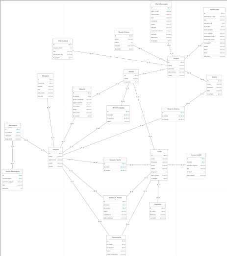

## 4. Projeto da solução

### 4.1. Modelo de dados

---

### 4.2. Tecnologias

_Serão utilizadas tecnologias consolidadas no desenvolvimento de aplicações web modernas, contemplando camadas de persistência, interface, lógica de negócio e infraestrutura. Para a camada de banco de dados, será empregado um Sistema de Gerenciamento de Banco de Dados relacional, garantindo integridade e eficiência no armazenamento. O desenvolvimento do front-end será realizado com um framework baseado em JavaScript e TypeScript, proporcionando uma interface reativa e escalável._

_No back-end, será adotado um framework robusto baseado em Java, voltado à construção de APIs RESTful e à gestão das regras de negócio. O versionamento e deploy da aplicação serão realizados por meio de plataforma de hospedagem integrada ao repositório de código. O ambiente de desenvolvimento será suportado por uma IDE amplamente utilizada no mercado, garantindo produtividade e padronização. Por fim, a comunicação entre usuários e/ou stakeholders será viabilizada por meio de uma plataforma de mensagens amplamente difundida._

| **Dimensão**   | **Tecnologia**  |
| ---            | ---             |
| SGBD           | MySQL           |
| Front end      | Framework React (JS, Typescript)     |
| Back end       | Java SpringBoot |
| Deploy         | Github Pages    |
| IDE         | Visual Studio Code    |
| Comunicação         | WhatsApp    |
